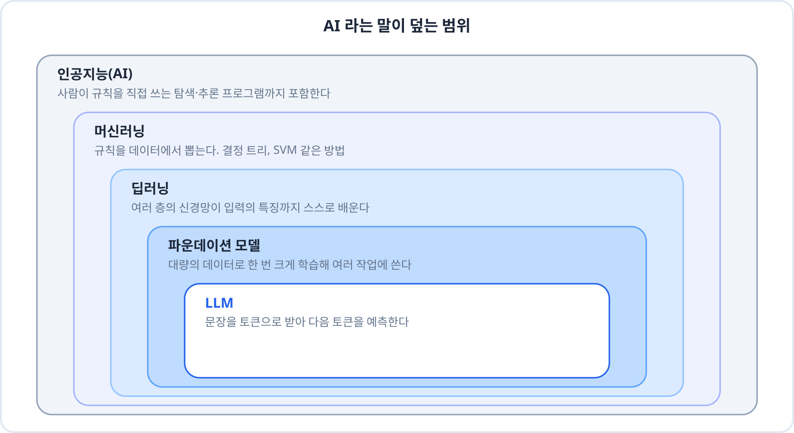
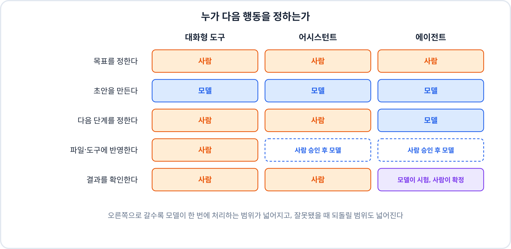
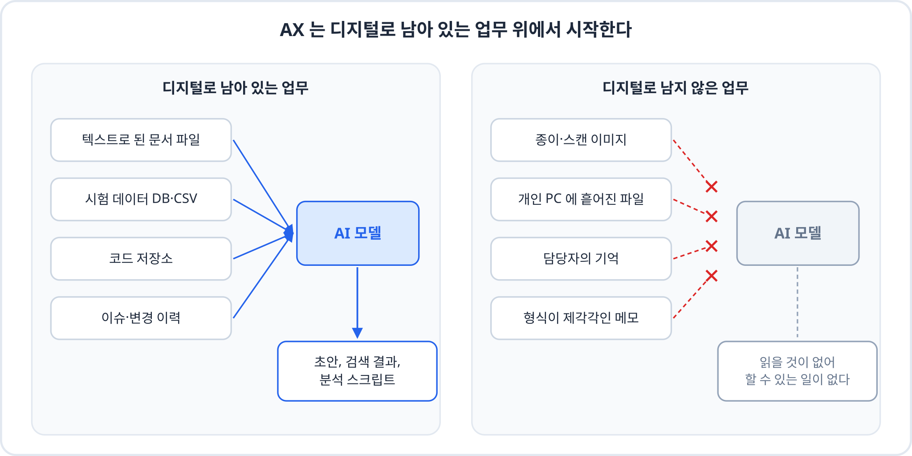

이번 장에서는 AI 와 AX 라는 말이 가리키는 범위를 다루겠다. 회의에서 AX 라는 말이 나오면 누구는 사내 챗봇을, 누구는 업무 자동화를, 누구는 데이터 분석을 떠올린다. 같은 말로 서로 다른 것을 이야기하면 논의가 맞물리지 않는다. 그래서 용어의 포함 관계, 지금의 생성형 AI 가 이전의 AI 와 무엇이 다른지, 도구가 사람 대신 어디까지 움직이는지, DX 와 AX 가 각각 무엇을 바꾸는지를 차례로 적어 두겠다.

* * *

## 1. AI, 머신러닝, 딥러닝

인공지능(artificial intelligence, AI)은 사람이 지능을 써서 하던 일을 컴퓨터가 하게 만드는 분야 전체를 가리킨다. 범위가 넓어서, 사람이 규칙을 하나하나 적어 넣은 프로그램도 여기에 든다. 체스 프로그램의 탐색이나 1980년대의 전문가 시스템(expert system)이 그런 예다.

머신러닝(machine learning)은 규칙을 사람이 쓰지 않고 데이터에서 뽑아내는 방법이다. 입력과 정답을 많이 보여 주면 프로그램이 둘 사이의 관계를 스스로 맞춘다.

레이다로 예를 들면 차이가 분명하다. 주변 잡음 세기를 재서 검출 문턱을 정하는 CFAR(constant false alarm rate) 검출기는 사람이 식으로 쓴 규칙이다. 반면 마이크로 도플러(micro-Doppler) 스펙트로그램을 보고 표적이 드론인지 새인지 가르는 분류기는 보통 라벨을 붙인 데이터로 학습시킨다. 앞의 것은 왜 그렇게 동작하는지 식으로 설명할 수 있고, 뒤의 것은 학습한 데이터가 동작을 정한다.

딥러닝(deep learning)은 머신러닝 가운데 여러 층의 신경망을 쓰는 방법이다. 예전 머신러닝은 어떤 특징(feature)을 볼지를 사람이 골라 줘야 했다. 스펙트로그램에서 대역폭과 주기 성분을 뽑아 분류기에 넣는 식이다. 딥러닝은 원래 데이터를 거의 그대로 넣어도 층을 거치며 쓸모 있는 특징을 스스로 만든다. 대신 데이터와 계산이 훨씬 많이 든다.

파운데이션 모델(foundation model)은 대량의 데이터로 한 번 크게 학습해 두고 여러 작업에 다시 쓰는 모델이다. 2021년 스탠퍼드 연구진이 붙인 이름이다. LLM(large language model, 대규모 언어 모델)은 그 가운데 글을 다루는 모델이다. 문장을 토큰이라는 조각으로 받아 다음 조각을 예측하도록 학습했다.

{: width="860"}
_그림 1. 안쪽으로 갈수록 범위가 좁아진다. 요즘 'AI 를 쓴다' 고 할 때 가리키는 것은 대부분 가장 안쪽의 LLM 이다._

생성형 AI(generative AI)라는 말도 자주 쓰인다. 글, 그림, 코드, 음성처럼 새로운 결과물을 만들어 내는 모델을 묶어 부르는 이름이다. LLM 은 글을 만드는 생성형 AI 이고, 그림을 만드는 확산 모델(diffusion model)도 생성형 AI 다. 여기서는 주로 LLM 을 보겠다.

* * *

## 2. 판별 모델과 생성 모델

모델이 무엇을 내놓는지로 나누면 두 갈래다.

판별 모델(discriminative model)은 입력을 받아 정해진 답 가운데 하나를 고른다. 표적 분류기가 드론, 새, 차량 중 하나를 내놓는 것이 그렇다. 답의 범위가 미리 정해져 있으므로 맞았는지 틀렸는지를 바로 셀 수 있다.

생성 모델(generative model)은 데이터가 어떻게 분포하는지를 배워서 그 분포에서 새 샘플을 만든다. LLM 은 지금까지의 문장 뒤에 어떤 토큰이 올 확률이 얼마인지를 배운 모델이다. 그 확률에서 토큰을 하나씩 뽑아 이어 붙이면 문장이 된다. 답의 범위가 열려 있어서 같은 질문에도 매번 조금씩 다른 답이 나올 수 있고, 맞고 틀림을 자동으로 가리기 어렵다.

이 차이는 업무에 붙일 때 그대로 드러난다. 판별 모델은 정확도를 숫자로 재고 기준을 넘으면 쓰면 된다. 생성 모델은 결과물마다 사람이 읽고 확인해야 하는 경우가 많고, 그 확인 시간이 효과를 좌우한다.

### 작업마다 모델을 만들던 방식과의 차이

LLM 이전에는 작업 하나에 모델 하나가 기본이었다. 문서 분류기를 만들려면 문서 수천 건에 라벨을 붙이고 그 작업 전용 모델을 학습했다. 요약기를 만들려면 또 다른 데이터를 모아 또 다른 모델을 학습했다.

2020년 GPT-3 논문은 다른 방식을 보여 줬다. 충분히 큰 언어 모델은 따로 학습하지 않아도, 입력 문장에 작업 설명과 예시 몇 개를 넣어 주면 그 작업을 해낸다. 이것을 few-shot 학습이라 부른다. 이후로는 같은 모델 하나에 지시문만 바꿔서 분류도 하고 요약도 하고 코드도 쓴다.

**업무 쪽에서 보면 준비 작업의 종류가 바뀌었다.** 예전에는 라벨 데이터를 모으고 모델을 학습하는 것이 준비였다면, 지금은 지시문을 쓰고 필요한 자료를 붙여 넣는 것이 준비다. 데이터 과학자가 없는 팀도 시도해 볼 수 있게 된 이유가 여기에 있다.

* * *

## 3. 지금까지의 흐름

| 시기 | 일 | 업무 쪽에서 달라진 점 |
| :--- | :--- | :--- |
| 2012 | AlexNet 이 이미지 인식 대회에서 기존 방법을 크게 앞섬 | 딥러닝이 영상·음성 인식의 기본 방법이 됨 |
| 2017 | 트랜스포머(Transformer) 구조 논문 | 긴 문장을 병렬로 학습할 수 있게 되어 모델 크기를 키울 길이 열림 |
| 2018 | GPT, BERT 공개 | 대량의 글로 먼저 학습하고 작업에 맞게 고쳐 쓰는 방식이 자리 잡음 |
| 2020 | GPT-3 공개 | 지시문과 예시만으로 작업을 바꾸는 방식이 가능해짐 |
| 2022.11 | ChatGPT 공개 | 대화창 하나로 누구나 쓰게 됨 |
| 2023 | LLaMA, Llama 2 같은 가중치 공개 모델 확산 | 모델을 사내 서버에 직접 설치해 돌리는 길이 생김 |
| 2023~2024 | 문서 검색 결합(RAG), 도구 호출, 긴 컨텍스트가 일반화 | 사내 문서와 시스템에 연결해 쓰는 사례가 늘어남 |
| 2024.11 | MCP(Model Context Protocol) 공개 | 모델과 사내 시스템을 잇는 방식에 공통 규약이 생김 |
| 2025 | 저장소를 읽고 명령을 실행하는 코딩 에이전트 확산 | 대화 상대에서 작업을 직접 진행하는 도구로 넓어짐 |

망분리 환경에서 눈여겨볼 줄은 2023년의 가중치 공개 모델이다. 그 전까지 쓸 만한 언어 모델은 대부분 공급자의 서버에서만 돌았다. 가중치가 공개되면서 인터넷이 끊긴 사내망에서도 모델을 돌릴 수 있게 됐다.

* * *

## 4. 대화형 도구, 어시스턴트, 에이전트

같은 LLM 이라도 업무에 들어오는 모양은 여러 가지다. 이것을 가르는 기준은 **다음에 무엇을 할지를 누가 정하는가**다.

대화형 도구는 사람이 묻고 모델이 답한다. 답을 읽고, 코드나 문서에 옮기고, 다음 질문을 정하는 것은 모두 사람이다. 모델은 초안을 만드는 일만 맡는다.

어시스턴트(assistant)는 편집기나 문서 도구 안에 들어와 있다. 작성 중인 코드의 다음 줄을 제안하거나, 선택한 문단을 고쳐 쓰는 식이다. 제안을 받아들일지는 사람이 정하지만, 받아들이면 도구가 바로 파일에 반영한다. 코파일럿(copilot)이라는 이름도 이 형태를 가리킬 때 쓴다.

에이전트(agent)는 목표를 받으면 할 일을 스스로 나누고, 도구를 불러 실행하고, 결과를 보고 다음 단계를 정한다. 코딩 에이전트라면 파일을 읽고, 고치고, 빌드하고, 오류가 나면 다시 고치는 과정을 사람이 매번 지시하지 않아도 이어 간다. 사람은 목표를 주고, 위험한 단계에서 승인하고, 마지막 결과를 확인한다.

{: width="860"}
_그림 2. 세 형태 모두 초안은 모델이 만든다. 다른 것은 그 뒤의 단계를 누가 이어 가느냐다._

자율성이 커질수록 한 번에 처리되는 일이 커진다. 모델이 잘못 판단했을 때 되돌려야 할 범위도 함께 커진다. 대화형 도구에서는 틀린 답을 안 쓰면 그만이지만, 에이전트가 파일 수십 개를 고친 뒤라면 무엇이 바뀌었는지부터 확인해야 한다. 그래서 에이전트를 쓸 때는 모델의 성능만큼이나 권한을 어디까지 줄지, 어느 단계에서 사람이 승인할지를 먼저 정해야 한다.

* * *

## 5. DX 와 AX

DX(digital transformation, 디지털 전환)는 종이와 수작업으로 하던 업무를 전산으로 옮기고 그 과정을 데이터로 남기는 일이다. 결재가 전자 결재 시스템으로, 시험 기록지가 CSV 와 데이터베이스로, 설계 문서가 버전 관리되는 파일로 바뀐 것이 DX 의 결과다.

AX(AI transformation, AI 전환)는 그렇게 디지털로 남은 업무와 데이터 위에서 AI 가 읽고, 쓰고, 일부 판단을 맡도록 일하는 방식을 바꾸는 일이다. 문서 초안을 AI 가 쓰고 사람이 고치거나, 시험 로그를 정리하는 스크립트를 AI 가 쓰거나, 사내 문서를 AI 가 찾아 근거와 함께 답하는 식이다.

| 구분 | DX | AX |
| :--- | :--- | :--- |
| 바꾸는 대상 | 업무의 매체. 종이에서 전산으로 | 업무를 처리하는 주체의 일부. 사람에서 사람과 AI 로 |
| 대표 결과물 | 전자 결재, 문서 관리 시스템, 시험 데이터베이스 | 초안 작성, 근거를 단 문서 검색, 분석 코드 생성, 에이전트 작업 |
| 실패하는 모양 | 시스템을 들였는데 종이와 병행해 일이 두 배가 됨 | 도구를 들였는데 결과를 확인하느라 시간이 줄지 않음 |
| 재는 것 | 전산 처리 비율, 처리 기간 | 작업 시간, 수정량, 결함, 실제 사용률 |

**AX 는 DX 위에서만 시작할 수 있다.** 모델이 읽을 수 있는 것은 텍스트와 데이터다. 설계 근거가 스캔한 이미지로만 남아 있거나, 시험 결과가 각자의 PC 에 서로 다른 형식으로 흩어져 있으면 모델이 아무리 좋아도 할 일이 없다.

{: width="860"}
_그림 3. 같은 모델이라도 읽을 수 있는 자료가 있는 업무에서만 쓸모가 생긴다. 오른쪽 업무는 모델을 고르기 전에 자료를 디지털로 남기는 일이 먼저다._

그래서 AX 를 시작하면서 처음 부딪히는 문제는 모델 성능이 아닌 경우가 많다. 문서가 어디에 몇 판으로 있는지, 시험 데이터 형식이 통일돼 있는지, 누가 어떤 자료에 접근할 수 있는지가 먼저 막힌다. 이것들은 AI 와 상관없이 DX 단계에서 정리됐어야 하는 일인데, AX 를 하려고 보면 비로소 드러난다.

도구를 들이는 것만으로 AX 가 되지 않는 이유도 여기에 있다. 각자 대화창에 질문하는 수준이면 개인의 작업이 조금 빨라질 뿐 검토 절차와 기록 방식은 그대로다. AI 가 만든 초안을 누가 어떻게 확인하는지, 그 결과를 어디에 남기는지까지 업무 절차에 들어가야 일하는 방식이 바뀐다.

* * *

## 6. AX 를 나눠 보는 단위

AX 를 논의할 때 범위를 세 단위로 나눠 두면 무엇이 필요한지가 갈린다.

| 단위 | 모습 | 필요한 것 |
| :--- | :--- | :--- |
| 개인 | 각자 질문하고 초안을 받아 자기 일에 쓴다 | 쓸 수 있는 도구, 넣어도 되는 자료의 기준, 결과를 확인하는 습관 |
| 팀 | 공용 지시문, 공용 확인 규칙, 팀 문서 검색을 함께 쓴다 | 같은 작업에 같은 결과가 나오게 하는 공용 자원, 검토 절차에 AI 단계를 넣는 합의 |
| 조직 | 업무 시스템과 모델을 연동하고 권한과 기록을 관리한다 | 서버와 모델 운영, 접근 권한, 감사 기록, 효과 측정 |

단위가 올라갈수록 효과가 커지지만 준비할 것도 늘어난다. 개인 단위는 도구만 있으면 바로 시작할 수 있다. 조직 단위는 서버, 보안 검토, 운영 인력이 있어야 한다.

지금 내가 직접 움직일 수 있는 것은 개인과 팀 단위다. 그래서 개인 업무에서 먼저 효과를 확인하고, 그 결과를 근거로 팀 단위로 넓히는 순서로 정리해 두겠다. 망분리 환경이라 외부 AI 서비스를 쓸 수 없다는 조건도 처음부터 깔고 간다.

* * *

## 7. 정리

| 질문 | 답 |
| :--- | :--- |
| AI 와 LLM 은 같은 말인가 | 아니다. AI 가 가장 넓고 머신러닝, 딥러닝, 파운데이션 모델 순으로 좁아지며, LLM 은 글을 다루는 파운데이션 모델이다 |
| 규칙 기반 프로그램과 머신러닝의 차이는 | 규칙을 사람이 식으로 쓰는가, 데이터에서 뽑는가다. CFAR 검출기는 앞의 것, 표적 분류기는 보통 뒤의 것이다 |
| LLM 이 이전 모델과 크게 다른 점은 | 작업마다 모델을 따로 학습하지 않고 지시문과 예시만 바꿔 여러 작업을 한다 |
| 생성 모델을 업무에 붙일 때 다른 점은 | 답의 범위가 열려 있어 결과물마다 확인이 필요하고, 그 확인 시간이 효과를 좌우한다 |
| 대화형 도구, 어시스턴트, 에이전트의 차이는 | 다음 행동을 누가 정하는가다. 에이전트로 갈수록 처리 범위와 되돌릴 범위가 함께 커진다 |
| DX 와 AX 의 차이는 | DX 는 업무를 전산으로 옮기는 일이고, AX 는 그렇게 남은 자료 위에서 AI 가 일부를 맡도록 일하는 방식을 바꾸는 일이다 |
| AX 를 막는 첫 문제는 | 모델보다 자료 상태인 경우가 많다. 텍스트로 없거나 흩어져 있는 자료는 모델이 읽지 못한다 |
| 어디서부터 시작하는가 | 개인 단위에서 효과를 확인하고, 그 결과로 팀 단위로 넓힌다 |

## 참고 자료

- S. Russell, P. Norvig, *Artificial Intelligence: A Modern Approach*, 4th ed., Pearson — AI 의 정의와 범위, 규칙 기반 시스템과 학습 기반 시스템의 구분
- I. Goodfellow, Y. Bengio, A. Courville, *Deep Learning*, MIT Press — 머신러닝과 딥러닝의 구분, 특징을 스스로 배우는 표현 학습
- R. Bommasani et al., "On the Opportunities and Risks of Foundation Models", arXiv:2108.07258, 2021 — 파운데이션 모델이라는 이름과 그 범위
- A. Krizhevsky, I. Sutskever, G. E. Hinton, "ImageNet Classification with Deep Convolutional Neural Networks", *NeurIPS*, 2012 — AlexNet
- A. Vaswani et al., "Attention Is All You Need", *NeurIPS*, 2017 — 트랜스포머 구조
- T. Brown et al., "Language Models are Few-Shot Learners", *NeurIPS*, 2020 — 지시문과 예시만으로 작업을 바꾸는 few-shot 학습
- Model Context Protocol 사양, modelcontextprotocol.io — MCP 의 구성과 공개 시점
