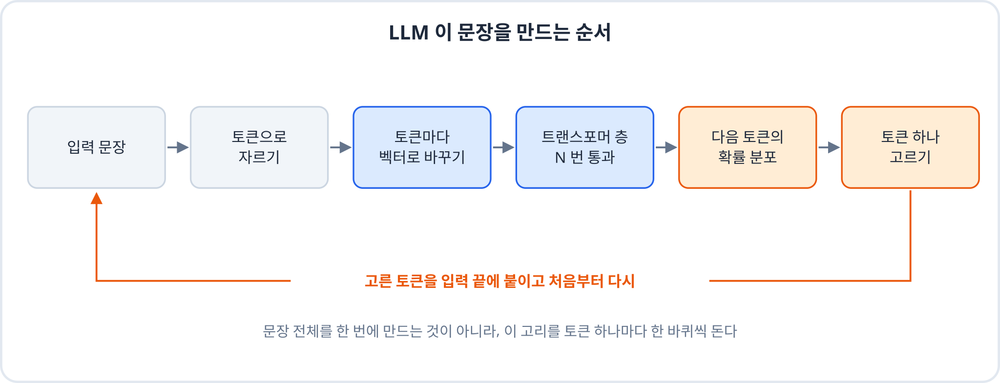
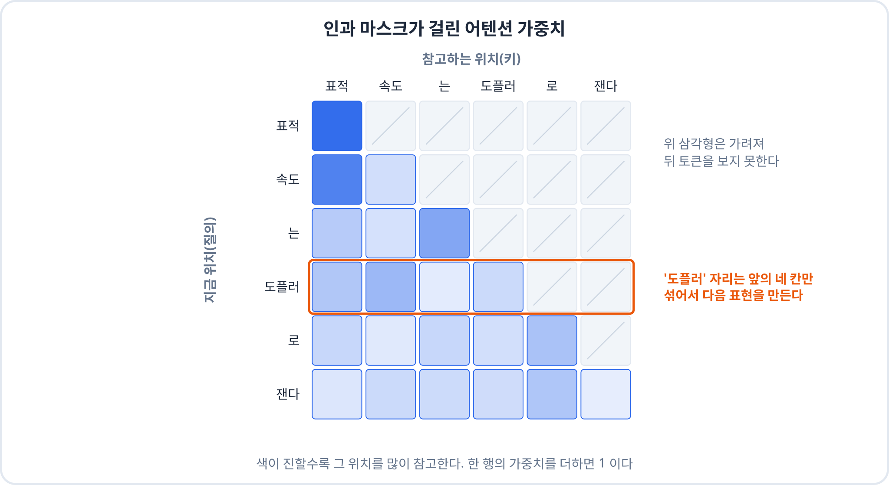
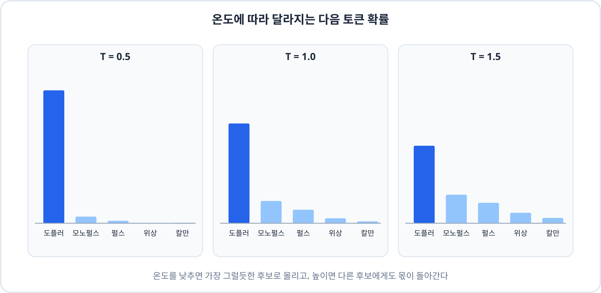

이번 장에서는 LLM 이 문장 하나를 만들어 내는 과정을 다루겠다. 업무에 붙일 때 부딪히는 문제들, 예를 들어 긴 문서를 넣으면 느려지는 것, 같은 질문에 답이 바뀌는 것, 없는 함수 이름을 지어내는 것은 모두 이 과정에서 나온다. 동작을 알아 두면 어떤 일을 맡기고 어떤 일을 맡기지 않을지 판단할 근거가 생긴다.

* * *

## 1. 한 토큰씩 이어 쓴다

LLM 은 문장 전체를 한 번에 만들지 않는다. 지금까지의 글을 보고 바로 다음에 올 조각 하나를 고르고, 그 조각을 글 끝에 붙여 다시 다음 조각을 고른다. 앞에서 만든 출력을 다시 입력으로 쓰는 이 방식을 자기회귀(autoregressive) 생성이라 한다.

{: width="860"}
_그림 1. 입력에서 토큰 하나가 나오기까지가 한 바퀴다. 답이 길면 그만큼 여러 바퀴를 돈다._

이 구조에서 몇 가지가 바로 따라 나온다. 답이 길수록 시간이 오래 걸린다. 한 번 고른 토큰은 되돌리지 않으므로, 초반에 방향을 잘못 잡으면 뒤의 문장이 그 방향을 따라간다. 그리고 매 바퀴마다 확률에서 하나를 뽑으므로 같은 질문에도 다른 답이 나올 수 있다.

* * *

## 2. 토큰

### 토큰이란

모델이 다루는 단위는 글자도 단어도 아닌 토큰(token)이다. 자주 나오는 문자열은 통째로 토큰 하나가 되고, 드문 문자열은 여러 토큰으로 쪼개진다. 어휘에 있는 토큰마다 번호가 붙어 있고, 모델에 들어가는 것은 이 번호의 나열이다.

### BPE

토큰 어휘를 만드는 대표적인 방법이 BPE(byte pair encoding)다. 처음에는 글자 하나하나를 토큰으로 두고, 학습용 글에서 가장 자주 붙어 나오는 두 토큰을 하나로 합친다. 합친 결과로 다시 빈도를 세고 또 합친다. 이것을 정해 둔 어휘 수가 될 때까지 되풀이한다.

작은 말뭉치로 직접 돌려 보면 이렇다. track 6 번, tracker 3 번, tracking 5 번, tracked 2 번, radar 4 번, radars 2 번이 나오는 글이고, 단어 끝에는 끝 표시를 붙였다. 처음에는 글자 단위라 전체가 159 토큰이다. 같은 빈도의 쌍이 여럿이면 그중 하나를 골라 합쳤다.

| 합친 순서 | 합친 쌍 | 그 쌍의 빈도 | 합친 뒤 전체 토큰 수 |
| ---: | :--- | ---: | ---: |
| 1 | r + a | 22 | 137 |
| 2 | t + ra | 16 | 121 |
| 3 | tra + c | 16 | 105 |
| 4 | trac + k | 16 | 89 |
| 5 | r + (끝) | 7 | 82 |
| 6 | track + (끝) | 6 | 76 |
| 7 | ra + d | 6 | 70 |
| 8 | rad + a | 6 | 64 |

여덟 번 합친 뒤 track 은 토큰 하나, tracking 은 track, i, n, g 와 끝 표시로 나뉘고, radar 는 rada 와 끝 표시가 붙은 r 두 개가 된다. 실제 토크나이저는 이 합치기를 십만 번 넘게 되풀이한다. Llama 3 의 어휘는 128,256 개다.

학습한 글에 많이 나온 표현일수록 적은 토큰으로 잘린다. 이것이 BPE 의 성질이고, 아래 한국어 문제도 여기서 나온다.

### 한국어와 숫자

실제 토크나이저는 글자가 아니라 UTF-8 바이트에서 시작하는 경우가 많다. 영문자는 한 글자가 1 바이트지만 한글 음절은 3 바이트다. 'radar' 는 5 바이트, '레이다' 는 9 바이트다. 학습한 글에 한국어가 영어보다 적으면 한국어 쪽에서 합쳐진 쌍이 적게 남고, 같은 뜻의 문장에 토큰이 더 든다. 얼마나 더 드는지는 토크나이저마다 다르므로, 쓸 모델의 토크나이저로 우리 문서를 직접 세어 보는 것이 정확하다.

토큰 수는 곧 비용이다. 모델이 한 번에 볼 수 있는 길이, 처리 시간, 메모리가 모두 토큰 단위로 정해진다.

숫자도 토큰으로 잘린다. 토크나이저에 따라 한 자리씩 또는 몇 자리씩 묶여 토큰이 된다. 모델은 자릿수를 맞춰 세로셈을 하는 방식으로 숫자를 보지 않는다. 큰 수의 곱셈이나 긴 표의 합계를 모델에게 직접 맡기면 틀리기 쉬운 이유 가운데 하나다.

* * *

## 3. 임베딩과 어텐션

### 임베딩

토큰 번호는 그대로는 크기 비교도 뜻도 없는 숫자다. 모델은 번호마다 정해 둔 벡터를 표에서 꺼내 쓴다. 이 벡터를 임베딩(embedding)이라 한다. 구조가 공개된 Llama 3.1 8B 에서는 토큰 하나가 4,096 개의 실수로 된 벡터가 된다. 쓰임이 비슷한 토큰은 학습을 거치며 서로 가까운 벡터가 된다.

### 어텐션

문장의 뜻은 단어 하나로 정해지지 않는다. '표적 속도는 도플러로 잰다' 에서 '도플러' 가 무엇을 재는 이야기인지는 앞의 '표적 속도' 가 있어야 분명해진다. 어텐션(attention)은 각 위치가 앞의 어느 위치를 얼마나 참고할지를 계산하고, 그만큼 섞은 새 벡터를 만드는 연산이다.

각 위치는 벡터 세 개를 만든다. 무엇을 찾는지를 나타내는 질의(query) $q$, 자신이 무엇인지를 나타내는 키(key) $k$, 실제로 넘겨줄 내용인 값(value) $v$ 다. 위치 $i$ 는 앞의 모든 위치 $j$ 의 키와 자기 질의를 내적해 점수를 매기고, softmax 로 합이 1 인 가중치로 바꾼 뒤, 그 가중치로 값을 더한다.

$$
\mathrm{Attention}(Q, K, V) = \mathrm{softmax}\!\left(\frac{QK^\top}{\sqrt{d_k}} + M\right)V
$$

$d_k$ 는 키 벡터의 차원이고, $M$ 은 마스크다. 글을 앞에서부터 만들어 가는 모델은 뒤에 올 토큰을 미리 볼 수 없어야 하므로, 자기보다 뒤 위치의 점수에 $-\infty$ 를 더해 가중치를 0 으로 만든다. 이것을 인과 마스크(causal mask)라 한다.

{: width="860"}
_그림 2. 각 행이 한 위치가 앞 위치들을 참고하는 비율이다. 위 삼각형은 가려져 있어서 어떤 위치도 자기보다 뒤의 토큰을 보지 못한다. 가중치는 임의의 질의·키 벡터로 계산한 것이라 볼 것은 모양이다._

어텐션은 여러 개를 나란히 돌린다. 이것을 헤드(head)라 하며, 헤드마다 다른 관계를 본다. Llama 3.1 8B 는 질의 헤드가 32 개다. 다만 키와 값은 8 벌만 만들어 질의 헤드 넷이 한 벌을 나눠 쓴다. 이렇게 묶는 방식을 GQA(grouped-query attention)라 하며, 6절의 메모리 계산에서 이 차이가 크게 드러난다.

### 층을 쌓는다

트랜스포머 층 하나는 어텐션 뒤에 MLP(multi-layer perceptron)를 붙인 것이다. 어텐션이 위치 사이에 정보를 섞는다면, MLP 는 위치마다 따로 벡터를 변환한다. Llama 3.1 8B 는 이런 층이 32 개다. 마지막 층을 지난 벡터로 어휘 전체에 대한 점수를 계산한다.

파라미터가 어디에 놓여 있는지 Llama 3.1 8B 의 구조로 세어 보면 다음과 같다. 정규화 층의 파라미터는 27 만 개 정도라 표에서 뺐다.

| 부분 | 파라미터 수 | 비율 |
| :--- | ---: | ---: |
| 입력 임베딩 표 | 5.25 억 | 6.5 % |
| 어텐션 (32 층) | 13.42 억 | 16.7 % |
| MLP (32 층) | 56.37 억 | 70.2 % |
| 출력 층 (어휘 점수) | 5.25 억 | 6.5 % |
| 합계 | 80.30 억 | 100 % |

파라미터의 70 % 가 MLP 에 있다. 모델이 학습한 사실 지식의 상당 부분이 MLP 가중치에 흩어져 저장된다는 연구가 있다(Geva et al., 2021). 특정 사실 하나가 어느 자리에 들어 있는지 꺼내 볼 수 없다는 점은 7절의 환각과 이어진다.

* * *

## 4. 다음 토큰 고르기

### 로짓에서 확률로

마지막 층은 어휘의 토큰마다 점수 하나를 낸다. 이 점수를 로짓(logit)이라 한다. 로짓을 확률로 바꾸는 것이 softmax 이고, 여기에 온도(temperature) $T$ 를 넣는다.

$$
p_i = \frac{\exp(z_i / T)}{\sum_j \exp(z_j / T)}
$$

$T$ 가 1 이면 학습한 분포 그대로다. 1 보다 작으면 큰 로짓과 작은 로짓의 차이가 벌어져 1 등 후보로 확률이 몰린다. 1 보다 크면 차이가 줄어 다른 후보에게도 확률이 돌아간다.

'표적의 속도는 ___ 효과로 잰다' 의 빈칸 후보 다섯 개에 로짓을 4.0, 2.5, 2.0, 1.0, 0.0 으로 두고 계산하면 이렇다. 로짓은 설명을 위해 정한 값이다.

| 후보 | 로짓 | $T=0.5$ | $T=1.0$ | $T=1.5$ |
| :--- | ---: | ---: | ---: | ---: |
| 도플러 | 4.0 | 0.934 | 0.701 | 0.545 |
| 모노펄스 | 2.5 | 0.046 | 0.156 | 0.200 |
| 펄스 | 2.0 | 0.017 | 0.095 | 0.144 |
| 위상 | 1.0 | 0.002 | 0.035 | 0.074 |
| 칼만 | 0.0 | 0.000 | 0.013 | 0.038 |

{: width="860"}
_그림 3. 같은 로짓이라도 온도를 낮추면 1 등 후보 하나로 몰리고, 높이면 엉뚱한 후보가 뽑힐 몫도 커진다._

$T=1.5$ 에서는 '칼만' 같은 엉뚱한 후보도 3.8 % 확률로 뽑힌다. 답이 백 토큰이면 이런 선택이 백 번 일어난다.

### top-p

엉뚱한 꼬리를 아예 잘라 내는 방법이 top-p 샘플링(nucleus sampling)이다. 확률이 큰 순서로 누적해서 $p$ 를 넘는 데까지만 후보로 남기고, 나머지는 버린 뒤 다시 정규화한다. 위 예에서 $T=1.0$, $p=0.9$ 면 도플러, 모노펄스, 펄스까지 누적 0.952 로 셋이 남고, 다시 정규화한 확률은 0.736, 0.164, 0.100 이 된다. 위상과 칼만은 뽑힐 수 없다.

### 업무에서 고르는 기준

코드, 표 추출, 형식이 정해진 문서처럼 정답에 가까운 출력이 필요하면 온도를 낮춘다. 아이디어를 여러 개 받아 보고 싶을 때는 온도를 올린다.

온도를 0 으로 두면 매번 1 등만 고르는 그리디(greedy) 방식이 된다. 그래도 실행할 때마다 출력이 완전히 같다고 보장되지는 않는다. GPU 의 병렬 연산은 더하는 순서에 따라 부동소수점 결과가 미세하게 달라질 수 있고, 함께 처리되는 요청이 바뀌면 그 순서가 바뀐다. 1 등과 2 등의 로짓이 거의 같은 자리에서는 이 미세한 차이로 고른 토큰이 바뀐다.

* * *

## 5. 학습 단계

### 사전학습

첫 단계인 사전학습(pre-training)에서는 대량의 글을 넣고 다음 토큰을 맞히게 한다. 정답 토큰에 모델이 준 확률이 $p$ 일 때 손실은 $-\ln p$ 다. 정답에 0.9 를 주면 손실이 0.105, 0.5 면 0.693, 0.01 이면 4.605 다. 이 손실을 수조 개 토큰에 걸쳐 줄이는 것이 사전학습이다.

사전학습만 마친 모델은 질문에 답하는 법을 모른다. 질문을 넣으면 답 대신 비슷한 질문 목록을 이어 쓰기도 한다. 학습한 글에 그런 패턴이 많았기 때문이다.

### 지시 튜닝

지시 튜닝(instruction tuning)은 지시와 그에 맞는 답을 짝지은 데이터로 더 학습시키는 단계다. 이 단계를 거쳐야 질문을 받으면 답하는 모델이 된다. 정답이 있는 데이터로 학습한다고 해서 SFT(supervised fine-tuning)라고도 부른다.

### 선호 학습

마지막으로 사람이 더 낫다고 고른 답 쪽으로 모델을 기울이는 선호 학습(preference learning)을 한다. 같은 질문에 대한 두 답 중 어느 쪽이 나은지 사람이 고른 데이터를 쓴다. 보상 모델을 따로 학습해 강화학습으로 맞추는 RLHF(reinforcement learning from human feedback)와, 선호 데이터에서 바로 모델을 고치는 DPO(direct preference optimization)가 대표적이다. 도움이 되는 답을 하고 해로운 요청을 거절하는 태도가 이 단계에서 만들어진다.

### 추론 모델

2024년부터는 답을 내기 전에 중간 추론 과정을 길게 생성하도록 학습한 모델이 나왔다. 여러 단계를 거쳐야 하는 수학, 코드, 계획 문제에서 정확도가 오른다. 대신 중간 과정도 토큰이라서 답 하나에 드는 시간과 토큰이 크게 늘어난다. 간단한 요약이나 형식 변환에는 쓸 필요가 없다.

### 학습 시점 이후의 일

모델은 학습 데이터를 모은 시점 이후의 일을 모른다. 공개된 적 없는 글은 처음부터 본 적이 없다. 사내 규격, 우리 코드베이스의 함수 이름, 지난달 시험 결과는 어떤 모델도 학습하지 않았다. 이런 것을 물으려면 해당 자료를 입력에 함께 넣어 줘야 한다.

* * *

## 6. 컨텍스트 창과 KV 캐시

### 컨텍스트 창

모델이 한 번에 볼 수 있는 토큰 수의 상한을 컨텍스트 창(context window)이라 한다. 입력과 출력을 합친 길이다. Llama 3.1 은 131,072 토큰, 흔히 128k 라고 부르는 길이다. 이 안에 넣은 것만 모델이 참고할 수 있다.

### KV 캐시

토큰을 하나 생성할 때마다 앞 위치 전부의 키와 값이 필요하다. 매번 처음부터 다시 계산하면 낭비이므로, 한 번 계산한 키와 값은 저장해 두고 새 토큰의 것만 덧붙인다. 이 저장소를 KV 캐시(key-value cache)라 한다.

토큰 하나당 KV 캐시 크기는 층마다 키와 값을 한 벌씩 두므로 다음과 같다.

$$
\text{토큰당 바이트} = 2 \times L \times n_{kv} \times d_{head} \times b
$$

$L$ 은 층 수, $n_{kv}$ 는 키·값 헤드 수, $d_{head}$ 는 헤드 하나의 차원, $b$ 는 값 하나의 바이트 수다. Llama 3.1 8B 는 $L=32$, $n_{kv}=8$, $d_{head}=128$ 이고 FP16 이면 $b=2$ 라서 토큰당 131,072 바이트, 곧 128 KiB 다.

| 컨텍스트 길이 | KV 캐시 (GQA, 키·값 8 벌) | 키·값을 32 벌 다 만들 때 |
| ---: | ---: | ---: |
| 4,096 토큰 | 0.54 GB | 2.15 GB |
| 8,192 토큰 | 1.07 GB | 4.29 GB |
| 32,768 토큰 | 4.29 GB | 17.18 GB |
| 131,072 토큰 | 17.18 GB | 68.72 GB |

같은 모델의 가중치는 FP16 으로 16.06 GB 다. **컨텍스트를 끝까지 채우면 요청 하나의 KV 캐시가 모델 가중치보다 커진다.** 여러 사람이 함께 쓰면 이 값이 동시에 처리 중인 요청 수만큼 곱해진다. GQA 로 키·값을 8 벌로 줄인 이유가 표 오른쪽 열에 있다.

### 길게 넣는다고 고르게 읽지는 않는다

컨텍스트 창이 크다고 그 안의 내용을 고르게 활용하는 것은 아니다. 긴 입력의 가운데 놓인 정보를 앞이나 끝에 놓인 정보보다 덜 활용한다는 실험 결과가 있다(Liu et al., 2024). 문서 수십 개를 통째로 넣기보다 질문과 관련된 부분만 골라 넣는 편이 빠르고, 메모리도 덜 들고, 답도 정확한 경우가 많다.

* * *

## 7. 환각

### 무엇인가

환각(hallucination)은 사실과 다르거나 근거 없는 내용을 그럴듯하게 만들어 내는 것을 말한다. 업무에서 자주 보는 모양은 이렇다.

- 없는 함수나 옵션 이름을 쓴 코드
- 존재하지 않는 논문, 규격 번호, 쪽수
- 원문에 없는 수치를 넣은 요약
- 중간에 자릿수를 틀린 계산

### 왜 생기는가

모델이 학습한 목표는 그럴듯한 다음 토큰이지 참인 다음 토큰이 아니다. 모르는 것을 물어도 확률 분포는 어떻게든 만들어지고, 거기서 토큰이 하나 뽑힌다. '모르겠다' 도 하나의 토큰열일 뿐이라서, 그쪽 확률이 높도록 학습되지 않았다면 그럴듯한 답이 먼저 나온다. 학습과 평가가 모른다고 답하는 것보다 추측해서 맞히는 쪽에 점수를 더 주기 때문에 이 경향이 굳어진다는 분석도 있다(Kalai et al., 2025).

드문 사실일수록 위험하다. 널리 알려진 공식은 학습한 글에 수없이 나왔으므로 확률이 한곳에 몰려 있다. 특정 규격의 조항 번호나 어떤 라이브러리 함수의 세 번째 인자처럼 드물게 나온 사실은 확률이 여러 후보로 퍼져 있고, 그중 그럴듯한 것이 뽑힌다. 레이다 쪽이라면 잘 알려진 레이다 방정식은 대체로 맞게 쓰지만, 특정 시험 규격의 조항 번호는 그럴듯하게 지어낼 수 있다.

### 줄이는 방법

환각은 모델을 바꿔도 없어지지 않는다. 줄이는 것은 쓰는 방식이다.

- 근거 문서를 입력에 함께 넣고, 그 문서 안에서만 답하게 한다
- 답의 각 주장에 출처 위치를 달게 해서 사람이 원문과 대조할 수 있게 한다
- 계산은 모델이 직접 하지 않고 계산하는 코드를 쓰게 한 뒤 그 코드를 실행한다
- 코드는 컴파일과 시험으로 확인한다. 없는 함수는 컴파일러가 바로 잡는다
- 확인할 수 없는 숫자와 고유명사는 원문을 보기 전까지 쓰지 않는다

**확인할 방법이 있는 출력만 그대로 쓴다.** 업무에 붙일 곳을 고를 때 이 기준이 가장 먼저 걸러 낸다.

* * *

## 8. 정리

| 질문 | 답 |
| :--- | :--- |
| LLM 은 문장을 어떻게 만드는가 | 다음 토큰 하나의 확률을 계산하고 하나를 고르는 일을 토큰마다 되풀이한다 |
| 토큰은 무엇인가 | 자주 나오는 문자열을 합쳐 만든 조각이다. 비용, 속도, 길이 제한이 모두 토큰 단위다 |
| 한국어가 불리한 점은 | 바이트로 보면 한글 음절이 3 바이트라서, 학습 글에 한국어가 적으면 같은 뜻에 토큰이 더 든다 |
| 어텐션은 무엇을 하는가 | 각 위치가 앞 위치들을 얼마나 참고할지 계산해 섞는다. 뒤 위치는 마스크로 가린다 |
| 파라미터는 어디에 있는가 | Llama 3.1 8B 기준 70 % 가 MLP 에, 17 % 가 어텐션에 있다 |
| 온도는 무엇을 바꾸는가 | 낮추면 1 등 후보로 확률이 몰리고 높이면 퍼진다. 업무용 출력은 낮게 둔다 |
| 온도 0 이면 늘 같은 답인가 | 아니다. 병렬 연산의 덧셈 순서 때문에 미세하게 달라질 수 있다 |
| 사내 자료를 모델이 아는가 | 모른다. 공개된 적 없는 자료는 입력에 넣어 줘야 한다 |
| 긴 문서는 그냥 다 넣으면 되는가 | KV 캐시가 토큰 수에 비례해 커지고 가운데 내용은 덜 활용된다. 필요한 부분만 넣는 편이 낫다 |
| 환각은 왜 생기는가 | 학습 목표가 그럴듯한 토큰이고, 모를 때도 무언가를 고르기 때문이다. 드문 사실일수록 틀리기 쉽다 |
| 환각은 어떻게 줄이는가 | 근거 문서를 넣고 출처를 달게 하고, 계산은 코드로, 코드는 컴파일과 시험으로 확인한다 |

## 참고 자료

- A. Vaswani et al., "Attention Is All You Need", *NeurIPS*, 2017 — 어텐션 식과 트랜스포머 층의 구성
- R. Sennrich, B. Haddow, A. Birch, "Neural Machine Translation of Rare Words with Subword Units", *ACL*, 2016 — BPE 로 하위 단어 어휘를 만드는 방법
- A. Grattafiori et al., "The Llama 3 Herd of Models", arXiv:2407.21783, 2024 — Llama 3.1 의 층 수, 헤드 수, 어휘 크기, 컨텍스트 길이
- J. Ainslie et al., "GQA: Training Generalized Multi-Query Transformer Models from Multi-Head Checkpoints", *EMNLP*, 2023 — 키·값 헤드를 묶는 GQA
- M. Geva et al., "Transformer Feed-Forward Layers Are Key-Value Memories", *EMNLP*, 2021 — MLP 층이 지식을 담는 방식
- A. Holtzman et al., "The Curious Case of Neural Text Degeneration", *ICLR*, 2020 — top-p 샘플링
- L. Ouyang et al., "Training Language Models to Follow Instructions with Human Feedback", *NeurIPS*, 2022 — 지시 튜닝과 RLHF
- R. Rafailov et al., "Direct Preference Optimization: Your Language Model is Secretly a Reward Model", *NeurIPS*, 2023 — DPO
- N. F. Liu et al., "Lost in the Middle: How Language Models Use Long Contexts", *TACL*, 2024 — 긴 입력의 가운데 정보를 덜 활용하는 현상
- A. T. Kalai, O. Nachum, S. S. Vempala, E. Zhang, "Why Language Models Hallucinate", 2025 — 학습과 평가가 추측을 부추기는 구조
