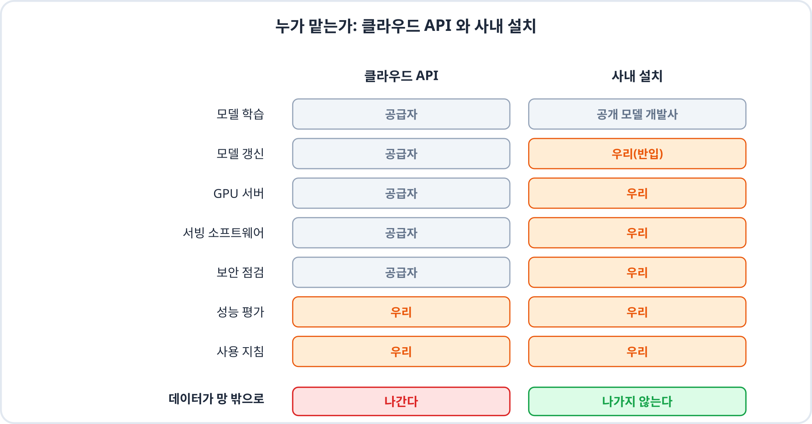
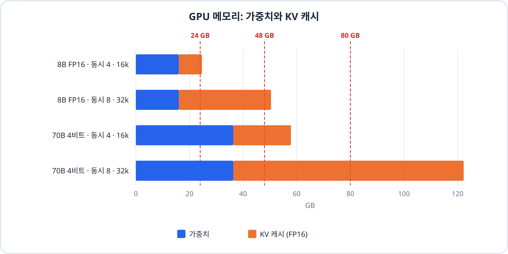
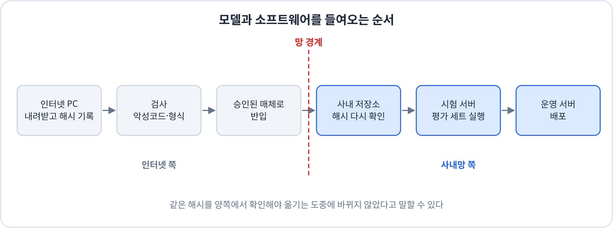

이번 장에서는 외부 AI 서비스를 쓸 수 없는 망분리 환경에서 AX 를 꾸리는 조건을 다루겠다. 내 근무 환경이 그렇다. 업무망이 인터넷과 분리돼 있어 클라우드 LLM 에 질문 하나 보낼 수 없다. 그래서 모델을 사내에 들여와 직접 돌리는 경우를 전제로, 하드웨어가 얼마나 필요한지, 무엇을 어떻게 들여오는지, 무엇을 규칙으로 정해 둬야 하는지를 정리해 두겠다.

* * *

## 1. 망분리 환경에서 달라지는 것

### 클라우드 API 와 사내 설치

클라우드 API 로 LLM 을 쓰면 모델 학습과 갱신, GPU 서버, 서빙 소프트웨어, 보안 점검을 모두 공급자가 맡는다. 사용자는 요청을 보내고 답을 받으면 된다. 대신 입력한 자료가 망 밖으로 나간다. 망분리 환경에서 막히는 것이 이 부분이다.

남는 길은 가중치가 공개된(open-weight) 모델을 사내 서버에 설치하는 것이다. 이렇게 하면 자료가 망 밖으로 나가지 않는다. 그 대신 공급자가 하던 일이 대부분 우리 쪽으로 넘어온다.

{: width="860"}
_그림 1. 사내 설치로 바꾸면 자료가 나가지 않는 대신 모델 갱신부터 보안 점검까지 공급자가 하던 일이 우리 쪽으로 온다. 성능 평가와 사용 지침은 어느 쪽이든 우리 몫이다._

| 항목 | 클라우드 API | 사내 설치 |
| :--- | :--- | :--- |
| 쓸 수 있는 모델 | 공급자의 최신 모델 | 가중치가 공개된 모델 |
| 모델 갱신 | 공급자가 바꾼다 | 우리가 골라서 들여온다 |
| 하드웨어 | 필요 없다 | GPU 서버를 산정하고 운영한다 |
| 비용 구조 | 쓴 토큰만큼 | 서버를 먼저 들이고, 많이 쓸수록 단가가 내려간다 |
| 운영 인력 | 거의 필요 없다 | 서빙, 모니터링, 보안 점검을 맡을 사람 |

### 기대치

가중치 공개 모델은 같은 시기의 최상위 상용 모델보다 성능이 낮은 경우가 많고, 그 차이는 모델과 작업에 따라 다르다. 게다가 사내 GPU 사정 때문에 공개 모델 가운데서도 큰 것을 못 돌릴 수 있다. 그래서 망분리 환경에서는 범위가 넓은 대화나 작문보다 범위를 좁힌 작업에 맞추는 편이 현실적이다. 정해진 형식의 요약, 코드 설명, 문서 검색, 스크립트 작성처럼 입력과 출력이 분명하고 결과를 확인할 수 있는 일이다.

### 제도 쪽의 움직임

공공 부문에서는 업무망을 일률적으로 끊는 방식에서 자료의 등급에 따라 통제를 달리하는 방식으로 옮겨 가고 있다. 국가정보원은 2025년에 국가 망 보안체계(N²SF) 가이드라인을 내고, 업무 정보를 기밀(C), 민감(S), 공개(O)로 나눠 등급마다 다른 보안 통제를 적용하게 했다. 등급이 낮은 자료부터 외부 서비스와 연결할 길이 열리는 방향이다. 다만 자료 분류가 끝나지 않았거나 이런 체계가 적용되지 않는 곳에서는 지금의 망분리가 그대로 전제다. 여기서는 그 경우를 본다.

* * *

## 2. 가중치 메모리

모델을 돌리려면 먼저 가중치 전체가 GPU 메모리에 올라가야 한다. 필요한 메모리는 파라미터 수에 파라미터 하나의 비트 수를 곱하면 나온다.

양자화(quantization)는 가중치를 더 적은 비트로 표현해 메모리를 줄이는 것이다. 학습에 쓰는 16 비트(FP16, BF16) 대신 8 비트나 4 비트로 줄인다. 4 비트 양자화는 가중치를 묶음으로 나눠 묶음마다 스케일 값을 붙이므로 실제로는 4 비트보다 조금 크다. 128 개 묶음마다 16 비트 스케일 하나를 붙이는 경우로 계산하면 파라미터당 4.125 비트다.

| 모델 | FP16 | 8 비트 | 4 비트 |
| :--- | ---: | ---: | ---: |
| Llama 3.1 8B (80.3 억) | 16.06 GB | 8.03 GB | 4.14 GB |
| Llama 3.1 70B (705.5 억) | 141.11 GB | 70.55 GB | 36.38 GB |

70B 모델은 FP16 그대로면 80 GB GPU 두 장에도 들어가지 않고, 4 비트로 줄여야 48 GB 한 장에 가중치가 올라간다. 8 비트는 대부분의 작업에서 품질 차이가 거의 없다는 결과가 있고(Dettmers et al., 2022), 4 비트는 방법에 따라 품질이 조금 떨어진다. GPTQ, AWQ 같은 방법이 4 비트에서 품질을 지키려고 나온 것이다. 우리 작업에서 얼마나 떨어지는지는 평가 세트로 직접 비교해야 안다.

* * *

## 3. KV 캐시와 동시 요청

가중치만 올라간다고 끝이 아니다. 요청마다 KV 캐시가 따로 필요하고, 그 크기는 토큰 수에 비례한다. KV 캐시가 무엇인지와 토큰당 크기를 구하는 식은 [1장](/posts/llm-basics/) 6절에 있다. Llama 3.1 8B 는 토큰당 128 KiB, 70B 는 층이 80 개라서 토큰당 320 KiB 다.

여러 사람이 함께 쓰면 동시에 처리 중인 요청 수만큼 KV 캐시가 곱해진다. 팀 규모의 사용을 두 경우로 잡아 계산했다. 동시에 처리 중인 요청 4 개에 요청마다 16k 토큰인 경우는 문서 검색 결과를 붙인 질문 정도이고, 동시 8 개에 32k 토큰인 경우는 그보다 넉넉하게 잡은 것이다.

| 모델과 정밀도 | 동시 요청 × 컨텍스트 | 가중치 | KV 캐시 (FP16) | 합계 | KV 캐시를 FP8 로 두면 |
| :--- | :--- | ---: | ---: | ---: | ---: |
| 8B, FP16 | 4 × 16k | 16.06 GB | 8.59 GB | 24.65 GB | 20.36 GB |
| 8B, FP16 | 8 × 32k | 16.06 GB | 34.36 GB | 50.42 GB | 33.24 GB |
| 8B, 4 비트 | 8 × 32k | 4.14 GB | 34.36 GB | 38.50 GB | 21.32 GB |
| 70B, 4 비트 | 4 × 16k | 36.38 GB | 21.47 GB | 57.85 GB | 47.12 GB |
| 70B, 4 비트 | 8 × 32k | 36.38 GB | 85.90 GB | 122.28 GB | 79.33 GB |

{: width="860"}
_그림 2. 동시 요청과 컨텍스트가 늘면 주황색 KV 캐시가 가중치보다 커진다. 모델을 4 비트로 줄여도 KV 캐시는 그대로 남는다._

**모델 크기만 보고 GPU 를 고르면 모자란다.** 8B 모델은 가중치만 보면 24 GB 카드에 들어가지만, 16k 토큰 요청 네 개만 함께 받아도 24 GB 를 넘는다. 서빙 소프트웨어의 작업 메모리와 중간 활성값도 따로 들므로 실제로는 표의 합계보다 여유가 더 있어야 한다.

KV 캐시를 FP8 로 저장하면 절반으로 줄고, vLLM 처럼 KV 캐시를 작은 블록 단위로 나눠 실제로 쓰는 만큼만 잡는 서빙 소프트웨어를 쓰면 낭비가 줄어든다(Kwon et al., 2023). 그래도 산정은 위 표처럼 넉넉하게 해 두고, 실제 사용 패턴을 보며 조정한다.

* * *

## 4. 생성 속도

### 토큰 생성은 메모리 대역폭에 묶인다

답을 한 토큰씩 생성하는 단계에서는 토큰 하나를 만들 때마다 가중치 전체를 메모리에서 한 번 읽어야 한다. 요청 하나만 처리할 때 이 단계는 계산보다 메모리를 읽는 속도에 묶인다. 그래서 초당 생성 토큰 수의 상한은 대략 메모리 대역폭을 가중치 크기로 나눈 값이다.

$$
\text{초당 토큰 수 상한} \approx \frac{\text{메모리 대역폭}}{\text{가중치 바이트 수}}
$$

| GPU (메모리, 대역폭) | 8B FP16 | 8B 4 비트 | 70B 4 비트 | 70B 8 비트 |
| :--- | ---: | ---: | ---: | ---: |
| RTX 4090 (24 GB, 1,008 GB/s) | 62.8 | 243.4 | 안 들어감 | 안 들어감 |
| RTX 6000 Ada (48 GB, 960 GB/s) | 59.8 | 231.9 | 26.4 | 안 들어감 |
| A100 SXM (80 GB, 2,039 GB/s) | 127.0 | 492.4 | 56.0 | 28.9 |
| H100 SXM (80 GB, 3,350 GB/s) | 208.6 | 809.1 | 92.1 | 47.5 |

이 값은 요청 하나일 때의 상한이다. 실제로는 KV 캐시도 읽어야 하고 연산 효율도 100 % 가 아니므로 이보다 낮다. 반대로 여러 요청을 묶어 처리하면 가중치를 한 번 읽어 여러 요청에 함께 쓰므로, 요청 하나의 속도는 조금 떨어져도 전체 처리량은 크게 늘어난다.

4 비트 양자화가 메모리만이 아니라 속도에도 효과가 있는 이유가 여기에 있다. 읽을 바이트가 4 분의 1 남짓으로 줄기 때문이다.

### 첫 토큰까지의 시간

생성을 시작하기 전에 입력 전체를 한 번 처리하는 단계가 있다. 이 단계는 입력 토큰을 한꺼번에 계산하므로 메모리보다 연산 능력에 묶인다. 연산량은 대략 파라미터 수의 2 배에 입력 토큰 수를 곱한 값이고, 입력이 길면 어텐션 점수 계산이 여기에 더 붙는다.

8B 모델에 16k 토큰을 넣으면 앞의 것이 $2.63 \times 10^{14}$ 번이고 어텐션 쪽이 그 27 % 쯤이다. GPU 가 실제로 초당 100 조 번(100 TFLOPS)을 낸다고 하면 3.3 초다. 70B 모델이면 초당 300 조 번을 내도 8.9 초가 걸린다.

사용자가 체감하는 것은 이 첫 토큰까지의 시간과 그 뒤 토큰이 나오는 속도 두 가지다. 문서 검색 결과를 많이 붙일수록 첫 토큰이 늦게 나온다. 검색 결과를 몇 개 붙일지는 정확도와 이 시간을 함께 보고 정한다.

* * *

## 5. 들여오는 절차

### 들여올 것

모델 하나를 돌리는 데 필요한 것은 모델 파일만이 아니다.

- 모델 가중치, 토크나이저 파일, 설정 파일
- 서빙 소프트웨어(vLLM, llama.cpp 같은 것)와 그 의존 패키지 전부
- GPU 드라이버와 CUDA 런타임
- 문서 검색을 하려면 임베딩 모델, 재순위 모델, 벡터 데이터베이스

인터넷이 되는 환경이라면 설치 중에 필요한 패키지를 알아서 내려받지만, 사내망에서는 하나라도 빠지면 설치가 멈춘다. 인터넷 쪽에서 사내 서버와 같은 운영체제, 같은 Python 버전을 기준으로 미리 전부 내려받아 묶어 가야 한다.

```bash
# 인터넷 쪽: 의존 패키지까지 wheel 파일로 모으고 해시를 기록한다
pip download -r requirements.txt -d wheels/ \
    --python-version 3.11 --platform manylinux2014_x86_64 --only-binary=:all:
sha256sum wheels/* model/*.safetensors > SHA256SUMS

# 사내 쪽: 해시를 다시 확인하고 인터넷 없이 설치한다
sha256sum -c SHA256SUMS
pip install --no-index --find-links wheels/ -r requirements.txt
```

컨테이너로 묶어 가는 방법도 있다. 인터넷 쪽에서 이미지를 만들어 파일로 저장하고 사내에서 불러온다. 이 경우에도 이미지 안에 무엇이 들었는지 목록을 남기고 해시를 확인한다.

{: width="860"}
_그림 3. 인터넷 쪽에서 기록한 해시를 사내 쪽에서 다시 확인하고, 운영 서버에 올리기 전에 시험 서버에서 평가 세트를 한 번 돌린다._

### 공급망 점검

- **파일 형식** — 가중치는 safetensors 형식을 고른다. PyTorch 의 옛 형식(.bin, .pt)은 Python 의 pickle 을 써서 파일을 불러오는 순간 그 안에 숨겨 둔 코드가 실행될 수 있다. safetensors 는 숫자 배열만 담는 형식이라 그런 경로가 없다
- **사용자 정의 코드** — 일부 모델은 저장소에 든 Python 코드를 함께 실행해야 돌아간다. Hugging Face 의 `trust_remote_code` 옵션이 그 경우다. 그런 모델은 그 코드까지 읽어 보고 들여오거나, 표준 구조로 도는 모델을 고른다
- **출처와 해시** — 개발사의 공식 저장소에서 받고, 공개된 해시나 서명이 있으면 대조한다. 이름이 비슷한 다른 사람의 재업로드 파일을 받지 않는다
- **의존 패키지 목록** — 무엇을 어느 버전으로 들여왔는지 남겨 둬야 나중에 특정 패키지에 취약점이 알려졌을 때 영향 여부를 바로 확인할 수 있다

### 갱신 주기

새 모델은 몇 달 간격으로 계속 나온다. 사내에서는 저절로 바뀌지 않으므로 갱신을 일정으로 잡는다. 분기마다 후보 모델을 골라 들여오고, 지금 쓰는 모델과 같은 평가 세트로 비교해서 나을 때만 바꾼다. 평가 세트 없이 바꾸면 무엇이 나아졌고 무엇이 나빠졌는지 알 수 없다.

* * *

## 6. 라이선스와 허용 용도

가중치가 공개됐다고 아무 용도로나 쓸 수 있는 것은 아니다. 라이선스는 크게 두 가지다.

- **일반 오픈소스 라이선스** — Apache 2.0, MIT 처럼 조건이 거의 없는 것. 고지 문구를 남기는 정도다
- **모델 전용 라이선스** — 개발사가 따로 만든 라이선스로, 사용자 수 조건, 이름 표기 의무, 허용 용도 정책(acceptable use policy)이 붙는다

레이다처럼 국방과 닿는 분야에서는 허용 용도 정책부터 읽어야 한다. 예를 들어 Llama 3.1 의 허용 용도 정책은 군사, 전쟁, 핵 산업, 첩보 용도로 쓰는 것을 금지 항목에 두고 있다. Meta 는 2024년 11월 미국 정부와 그 협력사에 한해 국가 안보 용도를 허용한다고 밝혔지만, 그 밖의 경우는 정책 문구 그대로다. 모델마다 라이선스가 다르므로 후보 모델을 고를 때 성능표와 함께 라이선스 원문을 확인한다.

* * *

## 7. 데이터 등급과 권한

### 사내망 안에서도 자료는 나뉜다

망분리는 자료가 밖으로 나가는 것을 막지만, 안에서 누가 무엇을 볼 수 있는지는 따로다. 업무 자료는 담당자만 보는 것, 부서 안에서만 보는 것, 사내 전체가 보는 것으로 나뉘어 있다. 보안 등급이 매겨진 자료는 처음부터 이 시스템에 넣지 않는다.

### 검색 단계에서 권한을 거른다

사내 문서를 전부 색인한 RAG 를 만들면, 권한이 없는 사람이 질문만으로 볼 수 없던 문서 내용을 받아 볼 수 있다. 청크마다 원문서의 접근 권한을 메타데이터로 붙이고, 검색할 때 질문한 사람의 권한으로 먼저 걸러야 한다. 검색해 온 뒤 답을 만들 때 거르려 하면 이미 모델 입력에 들어간 뒤라 늦다.

### 학습한 모델도 자료가 된다

사내 자료로 파인튜닝한 모델은 학습한 문장을 그대로 다시 내놓을 수 있다. 언어 모델에서 학습 데이터를 뽑아낼 수 있다는 것은 실험으로 확인돼 있다(Carlini et al., 2021). 그래서 민감한 자료로 학습한 모델 가중치는 그 자료와 같은 등급으로 다룬다. 권한이 다른 여러 부서가 함께 쓸 모델이라면 가장 넓게 공개된 자료로만 학습한다.

* * *

## 8. 로그와 감사

질문과 답에는 업무 자료가 그대로 들어 있으므로 로그도 자료다. 한편 로그가 없으면 무엇이 잘못됐는지 추적할 수 없고 효과도 잴 수 없다. 그래서 남기는 범위와 볼 수 있는 사람을 나눠 둔다.

| 남기는 것 | 보관 | 볼 수 있는 사람 |
| :--- | :--- | :--- |
| 사용자, 시각, 모델과 프롬프트 버전, 토큰 수, 호출한 도구 | 계속 남긴다 | 운영자 |
| 질문과 답의 원문 | 정해 둔 기간만 남긴다 | 권한을 따로 받은 소수 |
| 에이전트가 실행한 명령과 바꾼 파일 | 계속 남긴다 | 운영자, 해당 작업자 |

에이전트가 실행한 명령과 바꾼 파일 목록은 반드시 남긴다. 문제가 생겼을 때 사람이 한 일과 모델이 한 일을 가를 수 있어야 한다.

* * *

## 9. 위험과 사용 지침

### 사내망에서도 남는 위험

망분리가 막아 주는 것은 자료 유출 경로 하나다. LLM 을 붙이면서 생기는 위험 대부분은 사내망 안에서도 그대로 남는다. OWASP 의 LLM 애플리케이션 10 대 위험(2025)에서 이 환경에 해당하는 것을 골라 보면 이렇다.

| 위험 | 사내망에서 일어나는 모습 | 대책 |
| :--- | :--- | :--- |
| 프롬프트 주입 | 색인된 문서나 코드 주석 속 문장을 모델이 지시로 따른다 | 자료와 지시를 구분하고, 위험한 행동은 승인 없이는 실행되지 않게 막는다 |
| 민감 정보 노출 | 권한 밖 문서가 검색돼 답에 섞인다 | 검색 단계의 권한 필터, 로그 접근 제한 |
| 과도한 권한 | 에이전트가 지우거나 배포해서는 안 되는 것을 건드린다 | 읽기 권한부터 시작하고, 쓰기와 실행은 승인 |
| 벡터·임베딩 약점 | 색인에 잘못된 문서가 섞여 검색 결과를 오염시킨다 | 색인 대상 저장소를 정해 두고 추가 이력을 남긴다 |
| 잘못된 정보 | 그럴듯한 오답이 문서나 코드에 들어간다 | 출처 표시, 숫자는 코드로, 사람 검토 |
| 공급망 | 들여온 모델이나 패키지에 악성 코드가 있다 | safetensors, 해시 대조, 의존 패키지 목록 |

### 사용 지침에 넣을 것

시스템을 열기 전에 사용 지침부터 정한다. 짧아야 지켜진다.

- 넣어도 되는 자료와 넣으면 안 되는 자료의 기준
- AI 가 만든 결과물의 책임은 그것을 쓴 사람에게 있다는 것
- 코드는 리뷰와 정적 분석을 거친 뒤에만 반영한다는 것
- 문서에 들어가는 숫자와 결론은 원자료나 분석 코드로 확인한다는 것
- 에이전트에게 줄 수 있는 권한의 범위와 승인 절차
- 이상한 동작을 봤을 때 알릴 곳
- 모델과 공용 프롬프트를 바꿀 때 기록을 남긴다는 것

* * *

## 10. 정리

| 질문 | 답 |
| :--- | :--- |
| 망분리 환경에서 LLM 을 쓰는 길은 | 가중치가 공개된 모델을 사내 서버에 설치하는 것이다. 공급자가 하던 일이 우리 쪽으로 온다 |
| 무엇을 기대할 수 있는가 | 범위를 좁힌 작업이다. 형식이 정해진 요약, 코드 설명, 문서 검색, 스크립트 작성 |
| 가중치 메모리는 어떻게 구하는가 | 파라미터 수 × 비트 수다. 8B 는 FP16 으로 16.06 GB, 70B 는 4 비트로 36.38 GB 다 |
| 모델 크기만 보고 GPU 를 고르면 | 모자란다. 8B FP16 도 16k 요청 넷이면 KV 캐시까지 24.65 GB 로 24 GB 를 넘는다 |
| 생성 속도의 상한은 | 메모리 대역폭 ÷ 가중치 크기다. 4 비트로 줄이면 읽을 바이트가 줄어 빨라진다 |
| 첫 토큰은 왜 늦게 나오는가 | 입력 전체를 먼저 계산해야 해서다. 검색 결과를 많이 붙일수록 늦어진다 |
| 들여올 때 무엇을 보는가 | safetensors 형식, 사용자 정의 코드, 공식 출처와 해시, 의존 패키지 목록이다 |
| 라이선스에서 볼 것은 | 허용 용도 정책이다. 군사 용도를 막아 둔 모델이 있다 |
| 사내망이면 권한은 신경 쓰지 않아도 되는가 | 아니다. 검색 단계에서 질문한 사람의 권한으로 걸러야 한다 |
| 망분리로 막히지 않는 위험은 | 프롬프트 주입, 과도한 권한, 잘못된 정보, 공급망 위험은 안에서도 그대로다 |

## 참고 자료

- 국가정보원, *국가 망 보안체계(N²SF) 보안 가이드라인*, 2025 — 업무 정보의 C·S·O 등급 분류와 등급별 보안 통제
- A. Grattafiori et al., "The Llama 3 Herd of Models", arXiv:2407.21783, 2024 — Llama 3.1 8B·70B 의 구조
- Meta, *Llama 3.1 Acceptable Use Policy* — 군사·전쟁·핵·첩보 용도 금지 조항
- T. Dettmers et al., "LLM.int8(): 8-bit Matrix Multiplication for Transformers at Scale", *NeurIPS*, 2022 — 8 비트 추론의 품질
- E. Frantar et al., "GPTQ: Accurate Post-Training Quantization for Generative Pre-trained Transformers", *ICLR*, 2023 — 4 비트 양자화
- J. Lin et al., "AWQ: Activation-aware Weight Quantization for LLM Compression and Acceleration", *MLSys*, 2024 — 4 비트 양자화
- W. Kwon et al., "Efficient Memory Management for Large Language Model Serving with PagedAttention", *SOSP*, 2023 — KV 캐시를 블록으로 관리하는 vLLM
- NVIDIA, GeForce RTX 4090, RTX 6000 Ada, A100, H100 제품 사양 — 메모리 용량과 대역폭
- Hugging Face, *safetensors* 문서 — pickle 형식과의 차이
- N. Carlini et al., "Extracting Training Data from Large Language Models", *USENIX Security*, 2021 — 학습 데이터 추출
- OWASP, *Top 10 for LLM Applications 2025* — LLM 애플리케이션의 위험 분류
