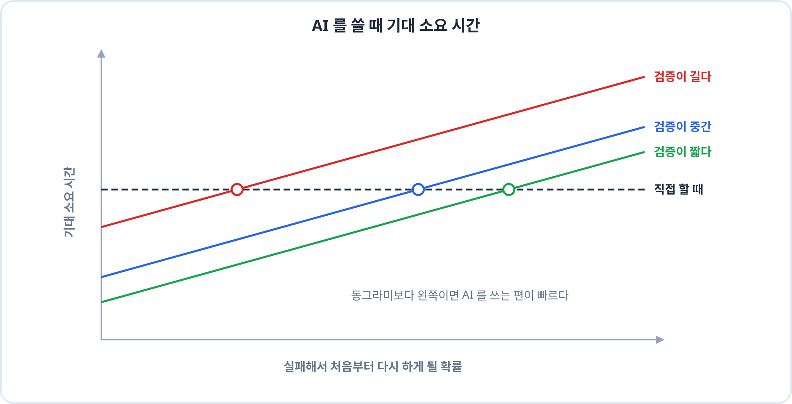
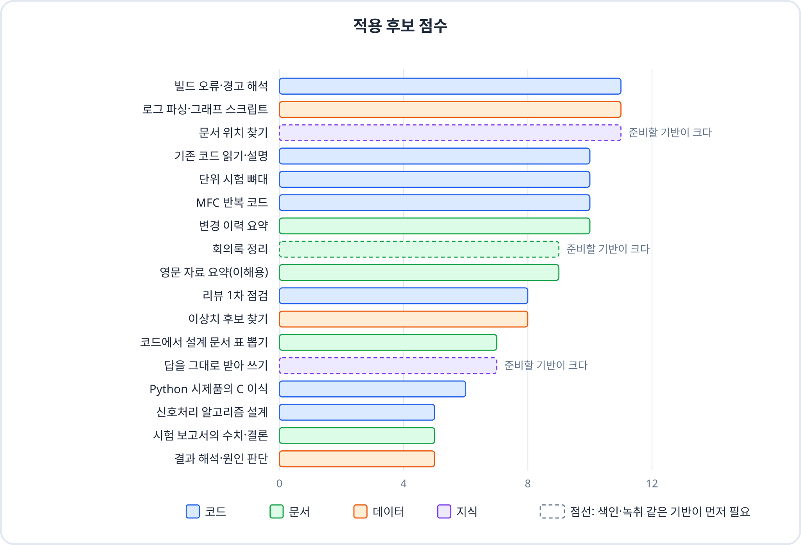

이번 장에서는 내 업무에서 AI 를 붙일 곳을 고르는 과정을 다루겠다. 도구부터 정하고 쓸 곳을 찾으면 쓰기 쉬운 곳에만 쓰게 되고, 정작 시간이 많이 드는 일은 그대로 남는다. 그래서 업무를 작게 쪼개고, AI 를 썼을 때 실제로 시간이 줄어드는 조건을 따져 보고, 그 기준으로 내 업무 네 영역을 하나씩 짚어 후보를 골라 두겠다. 망분리 환경이라 사내에 설치한 모델만 쓴다는 조건이다.

* * *

## 1. 업무를 단위 작업으로 쪼갠다

'코드 작성' 이나 '문서 작업' 단위로는 AI 를 붙일 곳이 보이지 않는다. 코드 작성 안에도 사양 읽기, 설계, 구현, 빌드 오류 잡기, 단위 시험 작성, 리뷰 반영, 문서 갱신이 섞여 있고, 이 가운데 AI 가 잘하는 일과 못하는 일이 갈린다.

그래서 일을 한 번 앉아서 끝내는 크기로 쪼개고, 두 주 정도 아래 양식으로 기록해 보기로 했다.

| 항목 | 적는 것 |
| :--- | :--- |
| 작업 | 한 번에 끝나는 단위. '빌드 경고 정리', '시험 로그에서 채널별 SNR 뽑기' 같은 것 |
| 걸린 시간 | 시작부터 끝까지. 결과를 확인하는 시간까지 넣는다 |
| 횟수 | 기록 기간 중 몇 번 했는지 |
| 입력 | 무엇을 보고 했는지. 코드, 문서, CSV, 사람의 설명 |
| 출력 | 무엇을 만들었는지. 코드, 표, 문단, 판단 |
| 확인 방법 | 맞았는지 어떻게 아는지. 컴파일, 시험, 원문 대조, 경험 |
| 자료 등급 | 사내 모델에 넣어도 되는 자료인지 |

기억으로 추정하지 않고 기록하는 이유는 짧은 일이 빠지기 때문이다. 자료 하나 찾는 데 10 분, 표 형식 맞추는 데 15 분 같은 일은 하루에 여러 번 있어도 기억에는 남지 않는다. AI 가 효과를 보기 쉬운 것이 바로 이런 일들이다.

* * *

## 2. 생성 시간보다 확인 시간

### 손익분기

AI 를 쓰면 쓰는 시간은 줄지만 결과를 확인하는 시간이 새로 생긴다. 작업을 직접 하면 $T$ 가 걸린다고 하자. AI 를 쓰면 지시를 쓰는 데 $t_p$, 결과를 확인하는 데 $t_v$ 가 들고, 확률 $q$ 로 결과를 못 쓰게 되어 처음부터 직접 다시 해야 한다고 하자. 그러면 기대 소요 시간은 다음과 같다.

$$
E = t_p + t_v + qT
$$

이 값이 직접 하는 $T$ 보다 작아야 AI 를 쓸 이유가 있다. 둘이 같아지는 실패 확률이 손익분기다.

$$
q^* = 1 - \frac{t_p + t_v}{T}
$$

직접 하면 60 분 걸리는 작업에 지시 작성 5 분을 두고 확인 시간을 바꿔 가며 계산하면 이렇다.

| 확인 시간 $t_v$ | 손익분기 실패 확률 $q^*$ | 실패 확률 0.2 일 때 기대 시간 | 실패 확률 0.5 일 때 기대 시간 |
| ---: | ---: | ---: | ---: |
| 10 분 | 0.75 | 27 분 | 45 분 |
| 20 분 | 0.58 | 37 분 | 55 분 |
| 40 분 | 0.25 | 57 분 | 75 분 |

{: width="860"}
_그림 1. 확인이 오래 걸리는 작업은 선이 위로 올라가 손익분기점이 왼쪽으로 밀린다. 그런 작업에서는 AI 가 거의 늘 맞아야 이득이다._

**확인 시간이 직접 하는 시간에 가까워지면 AI 가 꽤 잘 맞혀도 손해다.** 확인에 40 분이 드는 작업은 실패 확률이 0.25 만 넘어도 직접 하는 편이 빠르다. 반대로 확인이 10 분이면 넷 중 셋을 버려도 본전이다. 그래서 후보를 고를 때 AI 가 얼마나 잘하는지보다 결과를 얼마나 빨리 확인할 수 있는지를 먼저 본다.

### 확인을 건너뛰면

확인 시간을 줄이는 가장 쉬운 방법은 확인을 안 하는 것이고, 그래서 위험하다. 확인하지 않은 결과가 문서나 코드에 들어가면 그 오류는 나중에 발견된다. 결함은 늦게 발견될수록 고치는 비용이 커진다(Boehm, 1981). 시험 보고서에 들어간 틀린 숫자가 납품 뒤에 발견되면, 그 숫자를 만든 시간보다 훨씬 많은 시간이 든다. 그래서 위 식의 $t_v$ 는 줄일 대상으로 보지 않고, 확인이 빨리 끝나는 작업을 고르는 쪽으로 간다.

* * *

## 3. 후보를 고르는 기준

단위 작업마다 네 가지를 1 에서 3 으로 매긴다. 3 이 AI 에 유리한 쪽이다.

| 기준 | 3 | 1 |
| :--- | :--- | :--- |
| 총량 | 자주 하고 합친 시간이 크다 | 드물게 한다 |
| 형식 | 입력과 출력의 형식이 정해져 있다 | 매번 형식이 다르다 |
| 확인 | 컴파일, 시험, 원문 대조로 빨리 확인된다 | 확인하는 데 직접 하는 만큼 걸린다 |
| 오류 비용 | 틀려도 바로 드러나고 영향이 작다 | 틀리면 늦게 드러나고 영향이 크다 |

자료 등급은 점수가 아니라 거름망으로 쓴다. 사내 모델에도 넣을 수 없는 자료를 다루는 작업은 점수와 상관없이 뺀다. 그리고 점수와 따로, 시작하기 전에 갖춰야 할 기반이 큰지를 표시한다. 문서 검색은 점수가 높아도 색인과 권한 처리부터 해야 하므로 순서가 뒤로 밀린다.

* * *

## 4. C/C++ 코드 작성과 리뷰

| 작업 | 맡기는 정도 | 확인 방법 |
| :--- | :--- | :--- |
| 빌드 오류·경고의 원인 설명 | 높다 | 고친 뒤 다시 빌드한다 |
| 기존 코드의 흐름 설명 | 높다 | 내가 코드와 대조한다. 설명은 코드에 들어가지 않는다 |
| 단위 시험 뼈대 작성 | 높다 | 컴파일하고 실행한다. 기대값은 따로 정한다 |
| MFC 대화상자, 메시지 처리기 같은 반복 코드 | 높다 | 빌드하고 화면에서 동작을 본다 |
| 리뷰 1차 점검 | 중간 | 지적을 하나씩 확인한다. 놓치는 것과 잘못 짚는 것이 함께 있다 |
| Python 시제품을 C 로 옮기기 | 중간 | 같은 입력에서 두 구현의 출력을 비교한다 |
| 신호처리 알고리즘 설계, 고정소수점 스케일, 처리 주기 안에 끝나는지 | 낮다 | 확인하는 데 직접 하는 만큼 걸린다 |

### 기대값은 AI 에게 맡기지 않는다

단위 시험 뼈대를 AI 에게 맡길 때 지킬 것이 있다. 시험의 기대값을 AI 가 정하게 하면, 코드가 틀렸을 때 기대값도 같은 방식으로 틀릴 수 있다. 그러면 시험이 통과해도 아무것도 확인한 것이 아니다.

FFT 빈 번호를 시선 속도로 바꾸는 함수로 예를 들어 보겠다. 복소 IQ 신호를 $N$ 점 FFT 하면 빈 $k$ 의 주파수는 $k f_s / N$ 이고, 빈 번호가 $N/2$ 이상이면 음의 주파수라서 $f_s$ 를 뺀다. 도플러 주파수 $f_d$ 에서 속도는 $v = f_d \lambda / 2$ 다.

```c
/* FFT 빈 번호를 시선 속도[m/s]로 바꾼다. 다가오는 쪽이 양수. */
float f_BinToVelocity(int i_Bin, int i_NFft, float f_Fs, float f_Lambda)
{
    float f_Fd = (float)i_Bin * f_Fs / (float)i_NFft;

    if (i_Bin >= i_NFft / 2) {
        f_Fd -= f_Fs;
    }
    return f_Fd * f_Lambda * 0.5f;
}
```

시험 코드의 틀과 호출부는 AI 가 써도 된다. 기대값은 같은 식을 C 코드와 상관없이 따로 계산해서 넣는다. $N = 1024$, $f_s = 10$ kHz, $\lambda = 0.03$ m(10 GHz)로 계산하면 이렇다.

| 빈 번호 | 도플러 주파수 | 속도 |
| ---: | ---: | ---: |
| 0 | 0 Hz | 0 m/s |
| 100 | 976.5625 Hz | 14.6484375 m/s |
| 511 | 4,990.234375 Hz | 74.853515625 m/s |
| 512 | −5,000 Hz | −75 m/s |
| 1000 | −234.375 Hz | −3.515625 m/s |
| 1023 | −9.765625 Hz | −0.146484375 m/s |

511 과 512 처럼 경계 양쪽을 함께 넣는 것이 중요하다. 조건을 `>` 로 잘못 쓰면 512 에서 +75 m/s 가 나와 바로 걸린다. 실수 계산이므로 비교는 허용 오차를 두고 한다. 기대값을 이렇게 따로 만들어 두면 AI 가 쓴 시험이 무엇을 확인하는지 내가 안다.

### 리뷰 1차 점검

리뷰 점검은 사람 리뷰 앞에 한 단계를 더 두는 용도로 쓴다. 배열 경계, 초기화하지 않은 변수, 정수 나눗셈으로 잘리는 값, 부호가 다른 정수의 비교처럼 항목을 좁혀 주면 쓸 만한 지적이 나온다. 다만 지적이 맞는지 하나씩 확인해야 하고, 지적이 없다고 문제가 없는 것도 아니다. 정적 분석 도구를 대신하지는 못한다. 정적 분석이 낸 경고를 읽고 원인과 수정안을 설명하게 하는 쪽이 더 확실하다.

### Python 시제품을 C 로 옮길 때

신호처리는 Python 으로 먼저 확인하고 C 로 옮기는 경우가 많다. 옮기는 일 자체는 AI 가 잘하지만, 미묘하게 다른 결과를 내는 코드도 그럴듯하게 쓴다. 그래서 옮기기 전에 같은 입력 파일을 두 구현에 넣고 출력을 비교하는 시험부터 만든다. 비교 시험이 있으면 이 작업의 확인 점수가 올라가고, 없으면 맡기지 않는다.

* * *

## 5. 설계·시험 문서

| 작업 | 맡기는 정도 | 확인 방법 |
| :--- | :--- | :--- |
| 커밋 기록을 문서의 변경 내역으로 요약 | 높다 | 커밋 목록과 대조한다 |
| 회의 메모를 회의록 형식으로 정리 | 높다 | 참석자가 읽고 고친다 |
| 영문 규격·논문 요약(이해용) | 높다 | 필요한 부분은 원문을 본다 |
| 코드에서 함수 목록, 호출 관계 표 뽑기 | 중간 | 코드와 대조한다 |
| 시험 보고서의 수치와 결론 | 낮다 | 숫자는 분석 코드에서 와야 한다 |

문서 작업에서 AI 에게 맡기는 것은 형식과 문장이다. 숫자와 결론은 맡기지 않는다. 시험 보고서의 표는 분석 스크립트가 만든 출력을 그대로 붙이고, AI 는 그 표를 설명하는 문장의 초안만 쓴다.

회의록은 회의 메모가 텍스트로 있을 때 이야기다. 녹음을 글로 옮기려면 음성 인식 모델도 사내에 들여와야 하므로 준비할 것이 하나 더 는다.

HWP 문서도 걸린다. 사내 문서 양식이 HWP 인 경우가 많은데 모델은 텍스트를 읽는다. 바이너리 형식인 HWP 보다 XML 기반인 HWPX(KS X 6101, OWPML)로 저장하면 텍스트와 표를 꺼내기 쉽다. 문서를 새로 만들 때부터 HWPX 로 두면 이후의 검색과 요약이 쉬워진다.

* * *

## 6. 시험 데이터 분석

시험 데이터는 원칙이 분명하다. **데이터를 모델에게 주고 계산을 시키지 않는다. 분석 코드를 쓰게 하고 그 코드를 내가 돌린다.** 수천 줄짜리 CSV 를 입력에 넣으면 토큰도 많이 들고, 모델은 합계와 평균을 틀린다. 코드는 다시 돌려 볼 수 있고, 읽어서 확인할 수 있고, 다음 시험에도 쓸 수 있다.

예를 들어 시험 로그의 열 이름과 앞 몇 줄만 보여 주고, 스캔당 검출 수와 채널별 SNR 통계를 뽑는 스크립트를 쓰게 한다. 사내 PC 에 패키지를 새로 들이지 않아도 돌도록 표준 라이브러리만 쓰게 하면 이런 모양이 된다.

```python
import csv
from collections import defaultdict
from statistics import mean, stdev

per_scan = defaultdict(int)
snr = defaultdict(list)
with open("plots.csv", newline="") as f:
    for row in csv.DictReader(f):          # 열: scan, time_s, channel, range_m, az_deg, snr_db
        per_scan[row["scan"]] += 1
        snr[int(row["channel"])].append(float(row["snr_db"]))

counts = list(per_scan.values())
print("스캔당 검출 수: 평균 %.2f, 최소 %d, 최대 %d" % (mean(counts), min(counts), max(counts)))
for ch in sorted(snr):
    v = snr[ch]
    print("채널 %d: %d 개, SNR 평균 %.2f dB, 표준편차 %.2f, 최소 %.2f, 최대 %.2f"
          % (ch, len(v), mean(v), stdev(v), min(v), max(v)))
```

문법도 맞고 잘 돈다. 그런데 이 코드에는 빠진 것이 있다. 검출이 하나도 없는 스캔은 파일에 줄이 없으므로 `per_scan` 에 들어가지 않는다. 스캔 20 개 가운데 3 개에서 검출이 없도록 만든 모의 파일로 돌려 보면, 스캔당 검출 수 평균이 2.85 가 아니라 3.35 로 나오고 최소값은 0 이 아니라 1 로 나온다. 스캔 수는 파일이 아니라 시험 조건에서 와야 한다.

이런 것은 작은 파일로 손계산과 맞춰 볼 때 드러난다. 그래서 처음 한 번은 작은 파일로 결과를 맞춰 보고, 그 뒤로는 같은 스크립트를 계속 쓴다.

| 작업 | 맡기는 정도 | 확인 방법 |
| :--- | :--- | :--- |
| 로그 형식 파싱, 반복 그래프 스크립트 | 높다 | 작은 파일로 결과를 맞춰 본다 |
| 이상치 후보 찾기 | 중간 | 기준은 내가 정하고, 걸린 것을 직접 본다 |
| 결과 해석과 원인 판단 | 낮다 | 시스템을 아는 사람이 판단한다 |

이상치를 찾게 할 때는 기준을 내가 정한다. 평균에서 표준편차 3 배 밖, 같은 트랙에서 거리가 한 스캔 만에 500 m 넘게 튀는 점처럼 정해 주면 AI 는 그 기준을 코드로 옮기는 일만 한다. 기준을 AI 에게 맡기면 무엇을 이상치로 봤는지가 매번 달라진다.

* * *

## 7. 사내 지식 검색

내 업무에서 시간이 새는 곳 가운데 하나가 자료 찾기다. 문서가 여러 저장소에 흩어져 있고, 같은 문서가 여러 판으로 있고, 어떤 결정의 근거는 담당자의 기억에만 있다. RAG 를 붙이기 좋은 영역이지만 붙이기 전에 갖출 것이 많다.

- 문서를 텍스트로 꺼낼 수 있어야 한다(스캔 PDF, HWP)
- 어느 판이 최신인지 표시돼 있어야 한다
- 문서마다 누가 볼 수 있는지가 정해져 있어야 한다
- 잘 찾는지 확인할 질문 세트가 있어야 한다

맡기는 정도는 쓰는 방식에 따라 갈린다. 이 내용이 어느 문서 몇 절에 있는지를 찾게 하고 원문을 열어 확인하는 용도라면, 확인이 빠르고 틀려도 손해가 작다. 답을 받아 그대로 옮겨 쓰는 용도라면 확인할 방법이 원문을 다 읽는 것뿐이라 점수가 낮다. 그래서 처음에는 답이 아니라 위치를 찾는 도구로 쓰고, 답에는 반드시 문서 이름과 절을 달게 한다.

질문 세트는 동료들에게 실제로 받은 질문으로 만든다. 질문마다 정답 문서와 절을 적어 두면, 검색이 그 절을 상위 몇 개 안에 가져오는지 셀 수 있다.

* * *

## 8. 후보 정리

네 영역의 작업에 3절의 기준으로 점수를 매겼다. 점수는 지금 내 업무를 기준으로 한 판단이라 기록이 쌓이면 다시 매긴다.

| 작업 | 영역 | 총량 | 형식 | 확인 | 오류 비용 | 합계 | 먼저 갖출 기반 |
| :--- | :--- | ---: | ---: | ---: | ---: | ---: | :--- |
| 빌드 오류·경고 해석 | 코드 | 2 | 3 | 3 | 3 | 11 | |
| 로그 파싱·그래프 스크립트 | 데이터 | 3 | 3 | 3 | 2 | 11 | |
| 문서 위치 찾기 | 지식 | 3 | 2 | 3 | 3 | 11 | 색인, 권한 |
| 기존 코드 읽기·설명 | 코드 | 3 | 2 | 2 | 3 | 10 | |
| 단위 시험 뼈대 | 코드 | 2 | 3 | 3 | 2 | 10 | |
| MFC 반복 코드 | 코드 | 2 | 3 | 3 | 2 | 10 | |
| 변경 이력 요약 | 문서 | 2 | 3 | 3 | 2 | 10 | |
| 회의록 정리 | 문서 | 2 | 2 | 2 | 3 | 9 | 녹취 |
| 영문 자료 요약(이해용) | 문서 | 2 | 2 | 2 | 3 | 9 | |
| 리뷰 1차 점검 | 코드 | 2 | 2 | 2 | 2 | 8 | |
| 이상치 후보 찾기 | 데이터 | 2 | 2 | 2 | 2 | 8 | |
| 코드에서 설계 문서 표 뽑기 | 문서 | 1 | 2 | 2 | 2 | 7 | |
| 답을 그대로 받아 쓰기 | 지식 | 3 | 2 | 1 | 1 | 7 | 색인, 권한 |
| Python 시제품의 C 이식 | 코드 | 1 | 2 | 2 | 1 | 6 | |
| 신호처리 알고리즘 설계 | 코드 | 2 | 1 | 1 | 1 | 5 | |
| 시험 보고서의 수치·결론 | 문서 | 2 | 1 | 1 | 1 | 5 | |
| 결과 해석·원인 판단 | 데이터 | 2 | 1 | 1 | 1 | 5 | |

{: width="860"}
_그림 2. 위쪽은 확인이 빠르고 형식이 정해진 작업이다. 점선 막대는 점수가 높아도 색인이나 녹취 같은 기반이 먼저 있어야 한다._

점수가 같으면 준비할 것이 적은 쪽을 먼저 한다. 그래서 순서는 이렇게 잡았다.

1. 빌드 오류 해석, 기존 코드 설명, 단위 시험 뼈대. 사내 모델 하나와 편집기만 있으면 바로 시작할 수 있다
2. 로그 파싱과 그래프 스크립트. 모델이 쓴 코드를 내 PC 에서 돌리면 되므로 추가 기반이 없다
3. 변경 이력 요약과 영문 자료 요약. 문서 쪽에서 확인이 빠른 것부터 한다
4. 문서 위치 찾기. 점수는 높지만 색인, 최신판 표시, 권한 처리를 먼저 갖춰야 하므로 팀 단위 작업으로 넘긴다

아래쪽의 신호처리 알고리즘 설계, 시험 보고서의 결론, 결과 해석은 맡기지 않는다. AI 가 못하는 일이라서가 아니라, 확인하는 데 직접 하는 만큼 시간이 들고 틀렸을 때 늦게 드러나기 때문이다. 이런 일에서는 생각을 정리할 때 질문을 주고받는 상대로 쓰는 정도에 그친다.

* * *

## 9. 정리

| 질문 | 답 |
| :--- | :--- |
| 왜 업무를 쪼개는가 | '코드 작성' 안에도 AI 가 잘하는 일과 못하는 일이 섞여 있다. 한 번에 끝나는 크기로 쪼개야 갈린다 |
| 왜 기록하는가 | 짧고 잦은 일은 기억에 남지 않는데, AI 효과가 나기 쉬운 것이 그런 일이다 |
| AI 를 써서 손해 보는 조건은 | 확인 시간이 직접 하는 시간에 가까울 때다. 60 분 작업에 확인이 40 분이면 실패 확률 0.25 만 넘어도 손해다 |
| 확인을 줄이면 되지 않는가 | 확인하지 않은 오류는 늦게 드러나 더 큰 비용이 된다. 확인은 줄이지 않고, 확인이 빠른 작업을 고른다 |
| 무엇으로 점수를 매기는가 | 총량, 형식, 확인, 오류 비용을 1~3 으로 매기고, 자료 등급은 거름망, 필요한 기반은 따로 표시한다 |
| 코드에서 먼저 맡길 것은 | 빌드 오류 해석, 기존 코드 설명, 단위 시험 뼈대다. 시험 기대값은 따로 계산해 넣는다 |
| 문서에서 맡길 것은 | 형식과 문장이다. 숫자와 결론은 분석 코드와 사람이 맡는다 |
| 시험 데이터에서 맡길 것은 | 분석 코드 작성이다. 계산은 코드가 하고, 이상치 기준은 내가 정하고, 처음 한 번은 작은 파일로 맞춰 본다 |
| 사내 지식 검색은 | 효과가 크지만 색인, 최신판, 권한, 질문 세트를 먼저 갖춰야 해서 팀 단위로 넘긴다 |
| 맡기지 않는 것은 | 신호처리 알고리즘 설계, 시험 보고서의 결론, 결과 해석이다. 확인이 직접 하는 만큼 걸린다 |

## 참고 자료

- B. W. Boehm, *Software Engineering Economics*, Prentice Hall, 1981 — 결함을 늦게 발견할수록 커지는 수정 비용
- S. McConnell, *Software Estimation: Demystifying the Black Art*, Microsoft Press, 2006 — 작업을 작게 나누어 기록하고 추정하는 방법
- KS X 6101, *개방형 워드프로세서 마크업 언어(OWPML) 문서 구조* — HWPX 형식
- Python 표준 라이브러리 문서, *csv*, *statistics* — 분석 스크립트에 쓴 모듈
