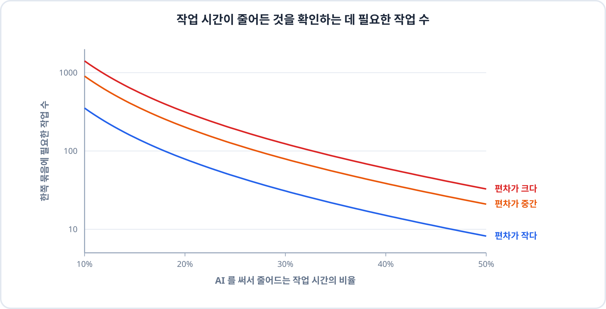
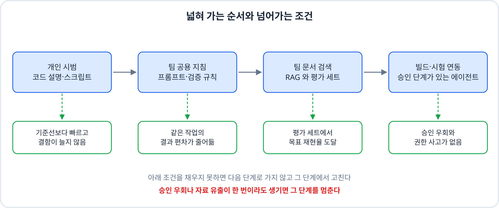

이번 장에서는 고른 후보를 실제로 써 보고 효과를 확인하는 방법을 다루겠다. AI 를 쓰면 빨라진 것 같은 느낌은 금방 든다. 그 느낌이 맞는지는 재 봐야 안다. 무엇을 재고, 얼마나 재야 차이를 말할 수 있고, 무엇을 보고 다음 단계로 넘어갈지를 정리해 두겠다.

* * *

## 1. 체감과 측정

AI 도구의 효과를 잰 연구들은 결과가 크게 엇갈린다.

| 연구 | 대상과 작업 | 결과 |
| :--- | :--- | :--- |
| Peng et al., 2023 | 개발자에게 JavaScript 로 HTTP 서버를 구현하게 하고 도구 사용 여부를 무작위로 배정 | 도구를 쓴 쪽이 55.8 % 빨리 끝냄. 95 % 신뢰구간은 21~89 % |
| Brynjolfsson et al., 2023 | 고객 상담원 5,179 명의 실제 업무 | 시간당 해결 건수가 평균 14 % 늘었고, 경력이 짧은 사람은 34 % 늘었고, 숙련자는 거의 변화가 없음 |
| Becker et al., 2025 (METR) | 숙련 오픈소스 개발자 16 명이 자기 저장소에서 한 실제 작업 246 건, 작업마다 무작위 배정 | AI 를 쓴 작업이 19 % 오래 걸림. 시작 전에는 24 % 빨라질 것으로 예상했고, 끝난 뒤에도 20 % 빨라졌다고 느낌 |

세 결과는 서로 모순이라기보다 조건이 다르다. 작고 새로 시작하는 작업, 경험이 적은 사람에게는 효과가 컸고, 자기가 잘 아는 큰 코드베이스에서 일하는 숙련자는 오히려 느려졌다. 그리고 METR 연구에서 보듯 **느려진 사람도 빨라졌다고 느꼈다.** 내 업무는 오래 다뤄 온 큰 코드베이스에서 하는 일이 많아 세 번째 경우에 가깝다. 체감으로 판단하면 안 되는 이유다.

연구 결과는 그 시점의 도구로 잰 것이라 도구가 바뀌면 숫자도 바뀐다. 그래서 남의 숫자를 빌려 오지 않고 내 작업에서 직접 잰다.

* * *

## 2. 기준선과 비교 방법

### 기준선

AI 를 쓰기 전에 고른 작업들에 걸리는 시간을 먼저 기록해 둔다. 기록 양식은 [4장](/posts/ax-workflow-analysis/) 1절에 있다. 기준선이 없으면 나중에 무엇과 비교할지가 없다.

### 전후 비교의 한계

가장 쉬운 방법은 도입 전 몇 주와 도입 후 몇 주를 비교하는 것이다. 문제는 그 사이에 다른 것도 바뀐다는 점이다. 같은 일을 반복하면 손에 익어 빨라지고, 프로젝트 단계가 바뀌면 작업의 난이도가 바뀐다. 전후 차이가 AI 때문인지 가릴 수 없다.

### 작업마다 무작위로 정한다

METR 연구가 쓴 방법은 혼자서도 쓸 수 있다. 비교할 종류의 작업이 생길 때마다, 시작하기 전에 AI 를 쓸지 말지를 무작위로 정한다. 어떤 작업에 AI 를 쓸지 내가 고르면 쉬워 보이는 작업에만 쓰게 되어 결과가 부풀려진다. 무작위로 정하면 그런 치우침이 양쪽에 고르게 나뉜다.

* * *

## 3. 지표

| 지표 | 재는 법 | 주의할 점 |
| :--- | :--- | :--- |
| 작업 시간 | 시작부터 확인이 끝날 때까지 | 확인 시간을 빼면 안 된다 |
| 수정량 | AI 초안에서 최종본까지 바뀐 줄의 비율 | 많이 고쳤다면 초안의 쓸모가 작다 |
| 결함 | 리뷰 지적, 시험 실패, 나중에 발견된 오류 | 늦게 발견되는 것까지 보려면 기간이 필요하다 |
| 사용률 | 쓸 수 있는 작업 가운데 실제로 쓴 비율 | 안 쓴 이유를 함께 적는다 |
| 재시도 | 같은 작업에서 다시 물어본 횟수 | 많으면 지시문이 부족하다는 신호다 |
| 만족도 | 작업 뒤 짧은 설문 | 보조 지표로만 쓴다. 체감은 틀릴 수 있다 |

수정량은 초안과 최종본을 비교하면 바로 나온다.

```python
import difflib

def changed_ratio(draft, final):
    """초안에서 최종본으로 가며 바뀐 줄 수를 최종본 줄 수로 나눈다."""
    a, b = draft.splitlines(), final.splitlines()
    sm = difflib.SequenceMatcher(None, a, b)
    changed = sum(max(i2 - i1, j2 - j1)
                  for tag, i1, i2, j1, j2 in sm.get_opcodes() if tag != "equal")
    return changed / max(len(b), 1)
```

네 줄짜리 반복문 초안에서 `i <= n` 을 `i < n` 으로 고쳤다면 한 줄이 바뀌어 0.25 다. 수정량이 작다고 좋은 것만은 아니다. 고쳐야 할 것을 못 보고 넘어가도 수정량은 작게 나온다. 그래서 결함 지표와 함께 본다.

* * *

## 4. 몇 번 재야 하는가

### 작업 시간은 편차가 크다

같은 종류의 작업이라도 걸리는 시간은 크게 다르다. 여기서는 작업 시간에 로그를 취하면 정규분포를 따른다고 보고, 로그 시간의 표준편차 $\sigma$ 로 편차를 나타낸다. $\sigma = 0.5$ 면 표준편차 하나 범위가 보통 작업의 0.61 배에서 1.65 배이고, $\sigma = 1.0$ 이면 0.37 배에서 2.7 배다.

### 필요한 작업 수

AI 를 쓴 묶음과 쓰지 않은 묶음의 평균 로그 시간을 비교한다고 하자. 시간이 비율 $r$ 만큼 줄어드는 효과를 양측 유의수준 5 %, 검정력 80 % 로 확인하려면 한 묶음에 필요한 작업 수는 다음과 같다.

$$
n = \frac{2\,(z_{0.975} + z_{0.8})^2\,\sigma^2}{\delta^2}, \qquad \delta = -\ln(1 - r)
$$

$z_{0.975} = 1.960$, $z_{0.8} = 0.842$ 다.

| 로그 시간의 표준편차 | 10 % 줄어듦 | 20 % 줄어듦 | 30 % 줄어듦 | 50 % 줄어듦 |
| ---: | ---: | ---: | ---: | ---: |
| 0.5 | 354 | 79 | 31 | 9 |
| 0.8 | 906 | 202 | 79 | 21 |
| 1.0 | 1,415 | 316 | 124 | 33 |

{: width="860"}
_그림 1. 효과가 작을수록, 작업마다 시간이 들쭉날쭉할수록 필요한 작업 수가 빠르게 늘어난다. 세로축은 로그 눈금이다._

**혼자 몇 주 해 보는 시범으로는 큰 효과만 확인할 수 있다.** 편차가 중간인 작업에서 20 % 단축을 확인하려면 묶음마다 202 개, 합쳐 400 개 넘는 작업이 필요하다. 반으로 줄어드는 효과라면 묶음마다 21 개로 된다.

그래서 시범에서는 효과가 클 것으로 보이는 작업을 고르고, 편차를 줄이는 방법을 함께 쓴다. 같은 종류의 작업끼리만 비교하고, 크기가 비슷한 작업을 짝지어 하나는 AI 로 하나는 직접 하면 편차가 줄어든다. 작은 효과를 확인하려면 팀 여러 명의 기록을 모아야 한다.

몇 번 써 보고 받은 인상으로는 20 % 정도의 차이를 우연과 구별할 수 없다.

* * *

## 5. 평가 세트

### 문서 검색

사내 문서 검색은 질문 세트로 잰다. 실제로 받은 질문을 모으고, 질문마다 정답 문서와 절을 적는다. 그리고 두 가지를 센다.

- **검색 재현율(recall@k)** — 정답 절이 상위 $k$ 개 결과 안에 들어온 질문의 비율
- **답의 정확도** — 사람이 읽고 맞았다고 판정한 답의 비율. 근거로 든 절이 실제로 그 내용을 담고 있는지도 함께 본다

### 50 개로 얼마나 말할 수 있는가

질문 50 개 가운데 40 개를 맞혔다면 정확도는 0.80 이다. 그런데 50 개는 적은 수라서 이 값의 불확실성이 크다. 비율의 95 % 신뢰구간을 Wilson 방법으로 구하면 이렇다.

| 맞힌 수 / 질문 수 | 정확도 | 95 % 신뢰구간 |
| ---: | ---: | :--- |
| 40 / 50 | 0.80 | 0.670 ~ 0.888 |
| 43 / 50 | 0.86 | 0.738 ~ 0.930 |
| 160 / 200 | 0.80 | 0.739 ~ 0.850 |
| 172 / 200 | 0.86 | 0.805 ~ 0.901 |

새 모델이 50 개 중 43 개, 지금 모델이 40 개를 맞혔다면 두 구간이 크게 겹친다. 이 결과만으로는 새 모델이 낫다고 말할 수 없다.

그래서 두 모델을 비교할 때는 같은 질문 세트로 돌리고 질문마다 결과를 짝지어 본다. 둘 다 맞힌 질문과 둘 다 틀린 질문은 차이를 알려 주지 않는다. 한쪽만 맞힌 질문이 어느 쪽으로 몰리는지를 본다. 이것이 McNemar 검정의 방식이다. 한쪽만 맞힌 질문이 10 개이고 그중 9 개가 새 모델 쪽이면 정확 이항 검정으로 양측 $p = 0.021$ 이라 우연으로 보기 어렵다. 7 개 중 6 개라면 $p = 0.125$ 로 아직 판단하기 이르다.

### 코드 작업

코드 작업은 지난 작업에서 평가 세트를 만든다. 이미 고쳐진 버그 열 개를 고르고, 고치기 전 코드와 그 버그를 잡는 시험을 함께 둔다. 모델이나 지시문을 바꿀 때마다 그 열 개를 다시 풀게 해서 시험을 통과한 수를 본다. 정답이 시험으로 정해져 있어 사람이 판정하지 않아도 된다.

### 모델이 채점하게 할 때

평가 세트가 커지면 답의 정확도를 사람이 다 읽기 어렵다. 그럴 때 다른 LLM 에게 채점을 맡기기도 한다. 이것을 LLM-as-a-judge 라 한다. 강한 모델의 판정이 사람의 판정과 상당히 맞는다는 결과가 있지만, 답이 놓인 순서나 답의 길이에 따라 점수가 흔들리고 자기가 생성한 답에 후한 경향도 함께 보고됐다(Zheng et al., 2023). 그래서 일부는 사람이 직접 채점해 모델 채점과 얼마나 맞는지 먼저 확인하고, 그 뒤에만 모델 채점을 쓴다.

### 바꿀 때마다 다시 돌린다

모델을 바꾸거나, 공용 프롬프트를 고치거나, 청크 크기를 바꾸면 평가 세트를 다시 돌린다. 결과는 날짜, 모델, 프롬프트 버전과 함께 표로 남긴다. 한 질문에서 좋아진 변경이 다른 질문에서 나빠지는 일이 있으므로, 전체 점수만 보지 않고 결과가 바뀐 질문을 하나씩 본다.

* * *

## 6. 운영하면서 보는 위험

시범을 하면서 위험도 함께 기록한다. 운영 규칙으로 정해 둔 대책이 실제로 지켜지는지를 보는 것이다.

| 볼 것 | 무엇으로 아는가 |
| :--- | :--- |
| 승인 없이 실행된 쓰기·실행 | 에이전트 실행 기록과 승인 기록의 대조 |
| 권한 밖 문서의 검색 | 검색 로그에서 질문자 권한과 문서 권한의 대조 |
| 확인 없이 반영된 결과 | 리뷰에서 발견된, AI 초안에서 온 결함 |
| 기대보다 낮은 사용률 | 쓰지 않은 이유 기록 |
| 판단을 넘겨 버리는 습관 | 리뷰에서 왜 이렇게 했는지 설명하지 못하는 경우 |

마지막 줄은 숫자로 잡기 어렵지만 중요하다. 지식 노동자를 조사한 연구에서, AI 를 믿을수록 비판적으로 검토하는 노력을 덜 들이는 경향이 보고됐다(Lee et al., 2025). 경력이 짧은 사람일수록 AI 의 결과를 검증할 근거가 적다. 팀으로 넓힐 때는 AI 가 만든 코드라도 작성자가 설명할 수 있어야 리뷰를 통과한다는 규칙을 둔다.

* * *

## 7. 넓혀 가는 순서

{: width="860"}
_그림 2. 각 단계는 아래 조건을 채워야 다음으로 넘어간다. 앞 단계의 기록이 다음 단계의 기준선이 된다._

| 단계 | 하는 일 | 넘어가는 조건 | 멈추는 조건 |
| :--- | :--- | :--- | :--- |
| 1. 개인 시범 | 코드 설명, 빌드 오류 해석, 분석 스크립트에 무작위 배정으로 써 본다 | 기준선보다 시간이 줄고 결함이 늘지 않는다 | 결함이 는다 |
| 2. 팀 공용 지침 | 쓸모가 확인된 지시문과 확인 규칙을 팀이 함께 쓴다 | 같은 작업에서 사람마다 결과 편차가 줄어든다 | 지침이 지켜지지 않는다 |
| 3. 팀 문서 검색 | 색인, 최신판 표시, 권한 필터를 갖춘 RAG 를 연다 | 평가 세트에서 정해 둔 재현율에 이른다 | 권한 밖 문서가 검색된다 |
| 4. 빌드·시험 연동 | 승인 단계를 둔 에이전트가 빌드와 시험을 돌린다 | 승인 우회와 권한 사고가 없다 | 승인 없는 쓰기·실행이 한 번이라도 생긴다 |

이 순서는 확인이 쉬운 것에서 어려운 것으로, 권한이 작은 것에서 큰 것으로 간다. 각 단계의 기록이 다음 단계를 열지 말지를 정하는 근거가 된다. 단계를 건너뛰어 처음부터 팀 전체에 에이전트를 열면 무엇이 효과를 냈고 무엇이 문제를 만들었는지 가릴 수 없다.

* * *

## 8. 정리

| 질문 | 답 |
| :--- | :--- |
| 체감으로 판단하면 안 되는가 | 안 된다. 숙련자가 19 % 느려졌는데도 20 % 빨라졌다고 느낀 연구가 있다 |
| 왜 기준선이 필요한가 | 도입 전 기록이 없으면 비교할 대상이 없다 |
| 전후 비교는 왜 부족한가 | 그 사이 숙련도와 작업 난이도도 바뀌어 AI 효과와 섞인다. 작업마다 무작위로 정한다 |
| 무엇을 재는가 | 확인까지 넣은 작업 시간, 수정량, 결함, 사용률이다. 만족도는 보조로만 쓴다 |
| 몇 번 재야 하는가 | 편차가 중간인 작업에서 20 % 단축을 보려면 묶음마다 202 개가 필요하다. 시범에서는 큰 효과만 확인된다 |
| 질문 50 개 평가 세트로 충분한가 | 정확도 0.80 의 신뢰구간이 0.67~0.89 다. 모델 비교는 같은 질문으로 짝지어 본다 |
| 모델이 채점해도 되는가 | 일부를 사람이 채점해 일치도를 확인한 뒤에 쓴다 |
| 무엇이 바뀌면 다시 재는가 | 모델, 공용 프롬프트, 청크 설정이 바뀔 때마다다 |
| 어떤 순서로 넓히는가 | 개인 시범, 팀 공용 지침, 팀 문서 검색, 빌드·시험 연동 순이다. 각 단계의 조건을 채워야 넘어간다 |

## 참고 자료

- S. Peng, E. Kalliamvakou, P. Cihon, M. Demirer, "The Impact of AI on Developer Productivity: Evidence from GitHub Copilot", arXiv:2302.06590, 2023 — 무작위 배정 실험과 55.8 % 단축
- E. Brynjolfsson, D. Li, L. R. Raymond, "Generative AI at Work", NBER Working Paper 31161, 2023 — 상담원 생산성 14 % 증가와 경력별 차이. *Quarterly Journal of Economics* 140(2), 2025 에 실렸다
- J. Becker, N. Rush, E. Barnes, D. Rein, "Measuring the Impact of Early-2025 AI on Experienced Open-Source Developer Productivity", arXiv:2507.09089, 2025 — 작업별 무작위 배정, 19 % 지연과 체감의 차이
- E. B. Wilson, "Probable Inference, the Law of Succession, and Statistical Inference", *Journal of the American Statistical Association*, 1927 — 비율의 신뢰구간
- Q. McNemar, "Note on the Sampling Error of the Difference Between Correlated Proportions or Percentages", *Psychometrika*, 1947 — 짝지은 비교
- J. Cohen, *Statistical Power Analysis for the Behavioral Sciences*, 2nd ed., Lawrence Erlbaum, 1988 — 검정력과 표본 수
- L. Zheng et al., "Judging LLM-as-a-Judge with MT-Bench and Chatbot Arena", *NeurIPS*, 2023 — 모델 채점과 사람 채점의 일치도, 채점 편향
- H.-P. Lee et al., "The Impact of Generative AI on Critical Thinking: Self-Reported Reductions in Cognitive Effort and Confidence Effects From a Survey of Knowledge Workers", *CHI*, 2025 — AI 에 대한 신뢰와 비판적 검토의 관계
- NIST, *Artificial Intelligence Risk Management Framework (AI RMF 1.0)*, NIST AI 100-1, 2023 — 위험을 측정하고 관리하는 단계의 구분
